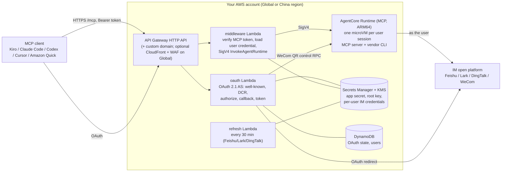

[Chinese](README.zh-CN.md) | English

# IM MCP server on Amazon Bedrock AgentCore (Feishu, Lark, DingTalk, WeCom)

One codebase, one config file, and one CDK app deploy a per-user MCP server for **one** of Feishu, Lark, DingTalk, or WeCom into **AWS Global or AWS China** regions, running on Amazon Bedrock AgentCore Runtime. AI clients (Kiro, Claude Code, Codex, Cursor, Amazon Quick) then read and write in the IM **as the individual signed-in user**, not as a shared bot, through the vendor's official CLI (`lark-cli`, `dws`, `wecom-cli`).

> [!IMPORTANT]
> **This is sample code, not production-ready.** It is provided for demonstration and learning. It has not been hardened, load-tested, or reviewed for your security, compliance, or availability requirements. Review the [security model](docs/en/security.md), test it in a non-production account, and make your own assessment before you use it with real users or data. You are responsible for the AWS charges and for complying with the terms of the IM platforms you connect to.

> [!WARNING]
> **AWS China regions (`cn-north-1`, `cn-northwest-1`): public access requires an ICP filing and a custom domain.**
> Without an ICP-filed domain, every request from the internet to the default API Gateway URL returns `403 Forbidden`. The stack still deploys and the backend works (verify with `npm run e2e:internal`), but MCP clients cannot reach it. Set `ingress.customDomain` to an ICP-filed domain and `ingress.certificateArn` to an ACM certificate in the same region. Amazon Quick is not available in AWS China; use Kiro, Claude Code, Codex, or Cursor.

## Documentation

| I want to… | Read |
|---|---|
| See what I must prepare before deploying | [Prerequisites](docs/en/prerequisites.md) |
| Create and configure the IM app | [Feishu](docs/en/im-setup-feishu.md) (with screenshots) · [Lark](docs/en/im-setup-lark.md) · [DingTalk](docs/en/im-setup-dingtalk.md) (with screenshots) · [WeCom](docs/en/im-setup-wecom.md) |
| Deploy to AWS Global or AWS China | [Deploy guide](docs/en/deploy.md) |
| **Connect Amazon Quick** (Default OAuth app, step by step with screenshots) | [Amazon Quick connector tutorial](docs/en/client-amazon-quick.md) (Feishu screenshots) · [DingTalk walkthrough](docs/en/quick-walkthrough-dingtalk.md) |
| Connect Kiro, Claude Code, Codex, or Cursor | [Connect an MCP client](#connect-an-mcp-client) |
| Test the deployment | [Testing](docs/en/testing.md) |
| Understand the security model | [Security](docs/en/security.md) |

## What you get

- **One IM per deployment**, selected by `im:` in `config/deploy.yaml`. The partition (`aws` or `aws-cn`) is derived from `region`; nothing else changes between Global and China.
- **Per-user identity.** Each user signs in with their own IM account (OAuth for Feishu/Lark/DingTalk, QR scan for WeCom). Their IM credential is stored in Secrets Manager under a dedicated KMS key, and each user gets their own AgentCore microVM session.
- **Standard MCP OAuth.** A self-hosted OAuth 2.1 authorization server (RFC 8414, RFC 9728, RFC 7591 dynamic client registration, PKCE S256) in Lambda. Clients connect with only the URL. No Amazon Cognito (not available in AWS China).
- **Curated tools plus the full CLI.** Each IM exposes a tier-1 tool list (26–32 tools) plus `<im>_discover` and `<im>_invoke`, which reach the rest of the vendor CLI catalog. Destructive tools require explicit confirmation.

## Architecture



Plain-text view:

```
MCP client --HTTPS--> API Gateway --> oauth Lambda      (sign-in, tokens)
                                  \-> middleware Lambda --SigV4--> AgentCore Runtime --> vendor CLI --> IM API
                                         |                          (microVM per user)
                       Secrets Manager (KMS) + DynamoDB
```

## Supported matrix

| IM | Auth mode | AWS Global | AWS China | Tested | Setup guide |
|---|---|---|---|---|---|
| Feishu (`feishu`) | OAuth redirect | Yes | Yes (ICP domain for public access) | Global: `e2e` 8/8 (ap-northeast-1, ap-southeast-1); **real Feishu tenant + Amazon Quick end to end** (ap-southeast-1). China cn-northwest-1: `e2e:internal` 7/7 (public URL 403 without ICP, as expected) | [Feishu](docs/en/im-setup-feishu.md) |
| Lark (`lark`) | OAuth redirect | Yes | Yes (cross-border traffic to Lark) | Synth matrix only | [Lark](docs/en/im-setup-lark.md) |
| DingTalk (`dingtalk`) | OAuth redirect | Yes | Yes (ICP domain for public access) | Global: `e2e` 8/8 (ap-northeast-1, ap-southeast-1); **real DingTalk organization + Amazon Quick end to end** (ap-southeast-1). China: synth matrix only | [DingTalk](docs/en/im-setup-dingtalk.md) |
| WeCom (`wecom`) | QR scan in the container | Yes | Yes (ICP domain for public access) | Global ap-northeast-1: `e2e` 8/8. China: synth matrix only | [WeCom](docs/en/im-setup-wecom.md) |

All 4 IMs × 2 partitions are covered by the synth-matrix unit tests. Real-tenant tests are a manual checklist in [docs/en/testing.md](docs/en/testing.md#3-real-tenant-manual-checklist-g2b). Supported regions: `infra/lib/regions.ts`.

## What you need before deploying

Read [docs/en/prerequisites.md](docs/en/prerequisites.md) (the full table), then the guide for your IM:

| IM | Guide |
|---|---|
| Feishu | [docs/en/im-setup-feishu.md](docs/en/im-setup-feishu.md) |
| Lark | [docs/en/im-setup-lark.md](docs/en/im-setup-lark.md) |
| DingTalk | [docs/en/im-setup-dingtalk.md](docs/en/im-setup-dingtalk.md) |
| WeCom | [docs/en/im-setup-wecom.md](docs/en/im-setup-wecom.md) |

In short: an AWS account and credentials for the target partition, Node.js 20.19+ (22 recommended), Docker that can build `linux/arm64`, the AWS CLI, an IM app (not needed for WeCom), and, for AWS China, an ICP-filed domain with an ACM certificate.

## Quick start

```bash
# 1. Install
npm ci

# 2. Configure (identifiers only, never secrets)
cp config/deploy.example.yaml config/deploy.yaml
#    edit region, im, slug and the IM block (for example feishu: { appId: cli_... })

# 3. Bootstrap CDK once per account and region
export AWS_PROFILE=<your-profile> AWS_REGION=<region>
npx cdk bootstrap aws://<account-id>/<region>

# 4. AWS China only: mirror the base image once per region
AWS_PROFILE=<your-china-profile> scripts/mirror-base-image.sh <cn-north-1|cn-northwest-1>

# 5. Deploy
npm run deploy -- -c config=config/deploy.yaml

# 6. Feishu / Lark / DingTalk: store the IM app secret (AFTER the deploy, which creates the secret)
npm run secret:set-im-app -- -c config=config/deploy.yaml

# 7. Register the stack output CallbackUrl in the IM developer console (not for WeCom)

# 8. Verify, then give users the stack output McpUrl
npm run e2e -- -c config=config/deploy.yaml
```

Details, options, and troubleshooting: [docs/en/deploy.md](docs/en/deploy.md).

## Verify

```bash
npm run e2e -- -c config=config/deploy.yaml            # 8 checks against the public URL
npm run e2e:internal -- -c config=config/deploy.yaml   # AWS China without ICP: invokes the Lambdas directly, 7 checks
```

The checks cover OAuth metadata, the 401 challenge, dynamic client registration, the redirect to the IM (or the WeCom QR page), `tools/list` with a test token through the Runtime, the `im_not_authorized` path, and route throttling. No IM credentials are needed. **Wait about 30 seconds between e2e runs**; the throttling check drains the rate-limit bucket on purpose. See [docs/en/testing.md](docs/en/testing.md).

## Connect an MCP client

Clients only need the `McpUrl` stack output (`<base>/mcp`). They register themselves (DCR), open a browser for sign-in, and refresh tokens on their own.

**Claude Code**

```bash
claude mcp add --transport http feishu https://<your-base>/mcp
```

Then run `/mcp` in Claude Code to authenticate.

**Kiro** (`.kiro/settings/mcp.json` in the workspace, or `~/.kiro/settings/mcp.json`)

```json
{
  "mcpServers": {
    "feishu": { "url": "https://<your-base>/mcp" }
  }
}
```

**Codex** (`~/.codex/config.toml`)

```toml
[mcp_servers.feishu]
url = "https://<your-base>/mcp"
```

Then run `codex mcp login feishu` to authenticate.

**Cursor** and other clients that support remote MCP servers with OAuth: add the same URL as a streamable HTTP server.

**Amazon Quick (AWS Global only)**: create an MCP connector with the `McpUrl` and set **Auth configuration** to **Default OAuth app**. Quick registers itself, so there is no Client ID to enter. Each user then signs in with their own IM account. Follow the [Amazon Quick connector tutorial](docs/en/client-amazon-quick.md), which has a screenshot of every step.

Use the IM name you deployed (`feishu`, `lark`, `dingtalk`, `wecom`) as the server name. Tool names are prefixed with it, for example `feishu_im_messages_send`, `dingtalk_calendar_event_list`, `wecom_doc_search`.

## Operations

```bash
npm run users -- list                  # users and status: active | pending_approval | revoked | replaced
npm run users -- approve <userId>      # WeCom with wecom.requireApproval: true
npm run users -- revoke <userId>       # disable a user and delete their IM credential
```

- Revocation is immediate for new logins and refresh grants. Access tokens already issued stay valid for up to 1 hour; the middleware caches IM credentials for up to 60 seconds.
- Logs: `/aws/lambda/im-mcp-<slug>-{oauth,middleware,refresh}`, `/aws/apigateway/im-mcp-<slug>-access`, and the Runtime log group `/aws/bedrock-agentcore/runtimes/<runtime-id>-DEFAULT`.
- Alarms go to the SNS topic in `AlarmTopicArn` (Lambda errors, API 5xx, token refresh failures, WeCom grant expiry). Set `alarm.webhookUrlSsmParam` to forward them to an IM bot webhook.

See [docs/en/deploy.md](docs/en/deploy.md#6-operations).

## Cleanup

```bash
npm run destroy -- -c config=config/deploy.yaml
npm run teardown:extras -- -c config=config/deploy.yaml
```

`destroy` removes the stack. `teardown:extras` then force-deletes the per-user secrets `<slug>/users/*` (created at runtime, so CloudFormation does not own them) and schedules deletion of the user-secret KMS key, which the stack keeps (`RETAIN`, about USD 1 per month until deleted). Still manual: the Runtime log group, CDK asset images in ECR, the China base-image mirror repository, and your DNS record and certificate. See [docs/en/deploy.md](docs/en/deploy.md#cleanup).

## Capability boundaries

| IM | Boundaries |
|---|---|
| All | Acts only as the signed-in user: no bot broadcast, no event subscriptions. Tools that need a local file inside the server (upload from or download to a path) are unavailable, because remote clients cannot pass files into the microVM. Commands that start local processes or daemons are disabled |
| Feishu / Lark | Scopes must be enabled in the developer console and the app version published; scope changes need a new version. A Feishu app cannot serve a Lark tenant, and vice versa |
| DingTalk | The org admin must enable **CLI access** for the organization (and keep it enabled). International DingTalk (`dingtalk.io`) is not supported |
| WeCom | **Each capability grant expires after 7 days and the user must renew it manually in the WeCom client** (platform policy, accepted for this sample; the service returns `im_grant_expired` and raises an alarm). **Chat history is unavailable in organizations with more than 10 members.** The bot does not inherit the user's document permissions. 50 calls per minute per bot. The QR flow has no tenant boundary, so turn on `wecom.requireApproval` |

## Security

- Secrets never go in the config file; the validator rejects secret-looking keys. The IM app secret is written by `npm run secret:set-im-app`.
- The container is reachable only through SigV4 `InvokeAgentRuntime` from the stack's Lambdas. Its execution role has no `bedrock:InvokeModel`.
- Per-user IM credentials are encrypted with a dedicated KMS key. MCP access tokens are HMAC-signed and expire after 1 hour.
- Destructive tools require `_confirm: true`. The LLM sets this flag itself, so use a client that shows tool calls for approval.
- **WeCom:** anyone with a WeCom account can complete the QR flow. Set `wecom.requireApproval: true` so new users wait for `npm run users -- approve`.

Full model, IAM summary, and known limitations: [docs/en/security.md](docs/en/security.md). To report a security issue, see [CONTRIBUTING.md](CONTRIBUTING.md#security-issue-notifications).

## Repository layout

| Path | Content |
|---|---|
| `infra/` | CDK app (`bin/app.ts`), typed config (`lib/config.ts`), constructs |
| `lambda/` | oauth, middleware, refresh, alarm Lambdas and IM OAuth adapters |
| `container/` | MCP server (`src/`), Dockerfile, CLI installer, tool catalogs (`tools/<cli>/`) |
| `config/` | `deploy.example.yaml`, generated Feishu/Lark scope list |
| `scripts/` | Operator scripts: secrets, users, e2e, base-image mirror, catalog generator, teardown |
| `shared/` | Names and versions shared by all parts |
| `test/` | vitest suites and fixtures |
| `docs/en/`, `docs/zh-CN/` | Documentation |

`container/tools/*/catalog.json` is generated by `npm run gen:catalog` from the pinned vendor CLIs' help output. It is kept in the vendors' original language (the DingTalk and WeCom CLIs ship Chinese help text) and remains under the vendors' licenses; see [THIRD-PARTY-LICENSES](THIRD-PARTY-LICENSES) and [NOTICE](NOTICE).

## Development

```bash
npm run build          # TypeScript type check
npm test               # unit, synth-matrix, and container tests
npm run gen:catalog    # regenerate tool catalogs after a CLI version bump
```

## License

This sample is licensed under the MIT-0 License. See [LICENSE](LICENSE). Third-party components and ported code are listed in [THIRD-PARTY-LICENSES](THIRD-PARTY-LICENSES) and [NOTICE](NOTICE).
