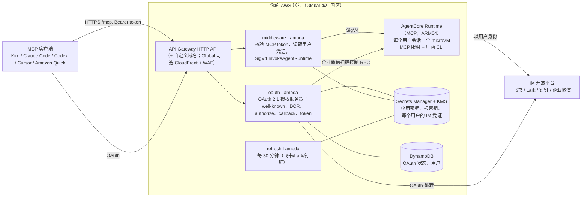

简体中文 | [English](README.md)

# 在 Amazon Bedrock AgentCore 上部署 IM MCP 服务（飞书、Lark、钉钉、企业微信）

一套代码、一个配置文件、一个 CDK 应用，即可把飞书、Lark、钉钉、企业微信中**任意一个** IM 的按用户隔离的 MCP 服务，部署到 **AWS Global 或 AWS 中国区**，运行在 Amazon Bedrock AgentCore Runtime 上。AI 客户端（Kiro、Claude Code、Codex、Cursor、Amazon Quick）通过厂商官方 CLI（`lark-cli`、`dws`、`wecom-cli`），**以每个登录用户本人的身份**在 IM 中读写，而不是使用共享机器人。

> [!IMPORTANT]
> **这是示例代码，不是生产就绪的代码。**仅用于演示和学习，没有针对你的安全、合规或可用性要求进行加固、压测或评审。在用于真实用户或真实数据之前，请先阅读[安全模型](docs/zh-CN/security.md)，在非生产账号中测试，并自行评估。AWS 费用以及遵守所接入 IM 平台的条款，由你自己负责。

> [!WARNING]
> **AWS 中国区（`cn-north-1`、`cn-northwest-1`）：公网访问必须有 ICP 备案和自定义域名。**
> 没有已备案的域名时，从公网访问默认 API Gateway URL 的所有请求都返回 `403 Forbidden`。Stack 仍可正常部署，后端也能工作（可用 `npm run e2e:internal` 验证），但 MCP 客户端无法访问。请把 `ingress.customDomain` 设为已完成 ICP 备案的域名，把 `ingress.certificateArn` 设为同一区域 ACM 中的证书。AWS 中国区没有 Amazon Quick，请使用 Kiro、Claude Code、Codex 或 Cursor。

## 功能概览

- **每个部署一个 IM**，由 `config/deploy.yaml` 中的 `im:` 选择。分区（`aws` 或 `aws-cn`）由 `region` 推导，Global 与中国区之间没有其他差异。
- **按用户的身份。**每个用户用自己的 IM 账号登录（飞书/Lark/钉钉走 OAuth，企业微信扫码）。用户的 IM 凭证保存在 Secrets Manager 中，使用专用 KMS 密钥加密；每个用户有自己的 AgentCore microVM 会话。
- **标准 MCP OAuth。**在 Lambda 中自建 OAuth 2.1 授权服务器（RFC 8414、RFC 9728、RFC 7591 动态客户端注册、PKCE S256）。客户端只需要 URL 即可连接。不依赖 Amazon Cognito（AWS 中国区没有）。
- **精选工具 + 完整 CLI。**每个 IM 提供一组 tier-1 工具（26–32 个），另有 `<im>_discover` 和 `<im>_invoke` 可调用厂商 CLI 工具目录中的其余命令。破坏性工具需要显式确认。

## 架构



纯文本示意：

```
MCP 客户端 --HTTPS--> API Gateway --> oauth Lambda      （登录、token）
                                  \-> middleware Lambda --SigV4--> AgentCore Runtime --> 厂商 CLI --> IM API
                                         |                          （每个用户一个 microVM）
                       Secrets Manager (KMS) + DynamoDB
```

## 支持矩阵

| IM | 授权方式 | AWS Global | AWS 中国区 | 测试情况（基础设施层面，未使用真实 IM 租户） |
|---|---|---|---|---|
| 飞书（`feishu`） | OAuth 跳转 | 支持 | 支持（公网访问需备案域名） | Global ap-northeast-1：`e2e` 8/8。中国区 cn-northwest-1：`e2e:internal` 7/7（无 ICP 时公网 URL 返回 403，符合预期） |
| Lark（`lark`） | OAuth 跳转 | 支持 | 支持（访问 Lark 需跨境） | 仅 synth 矩阵 |
| 钉钉（`dingtalk`） | OAuth 跳转 | 支持 | 支持（公网访问需备案域名） | Global ap-northeast-1：`e2e` 8/8。中国区：仅 synth 矩阵 |
| 企业微信（`wecom`） | 容器内扫码 | 支持 | 支持（公网访问需备案域名） | Global ap-northeast-1：`e2e` 8/8。中国区：仅 synth 矩阵 |

4 个 IM × 2 个分区全部由 synth 矩阵单元测试覆盖。真实租户测试是 [docs/zh-CN/testing.md](docs/zh-CN/testing.md#3-真实租户手工检查清单g2b) 中的手工检查清单。受支持区域见 `infra/lib/regions.ts`。

## 部署前需要准备什么

先阅读 [docs/zh-CN/prerequisites.md](docs/zh-CN/prerequisites.md)（完整清单），再阅读对应 IM 的配置指南：

| IM | 指南 |
|---|---|
| 飞书 | [docs/zh-CN/im-setup-feishu.md](docs/zh-CN/im-setup-feishu.md) |
| Lark | [docs/zh-CN/im-setup-lark.md](docs/zh-CN/im-setup-lark.md) |
| 钉钉 | [docs/zh-CN/im-setup-dingtalk.md](docs/zh-CN/im-setup-dingtalk.md) |
| 企业微信 | [docs/zh-CN/im-setup-wecom.md](docs/zh-CN/im-setup-wecom.md) |

简单来说：目标分区的 AWS 账号和凭证、Node.js 20.19+（推荐 22）、能构建 `linux/arm64` 的 Docker、AWS CLI、一个 IM 应用（企业微信不需要），以及 AWS 中国区需要的已备案域名和 ACM 证书。

## 快速开始

```bash
# 1. 安装依赖
npm ci

# 2. 配置（只填标识，绝不填密钥）
cp config/deploy.example.yaml config/deploy.yaml
#    编辑 region、im、slug 和 IM 块（例如 feishu: { appId: cli_... }）

# 3. 每个账号每个区域执行一次 CDK bootstrap
export AWS_PROFILE=<your-profile> AWS_REGION=<region>
npx cdk bootstrap aws://<account-id>/<region>

# 4. 仅 AWS 中国区：每个区域同步一次基础镜像
AWS_PROFILE=<your-china-profile> scripts/mirror-base-image.sh <cn-north-1|cn-northwest-1>

# 5. 部署
npm run deploy -- -c config=config/deploy.yaml

# 6. 飞书 / Lark / 钉钉：写入 IM 应用密钥（必须在部署之后，密钥由部署创建）
npm run secret:set-im-app -- -c config=config/deploy.yaml

# 7. 在 IM 开发者后台登记 Stack 输出 CallbackUrl（企业微信不需要）

# 8. 验证，然后把 Stack 输出 McpUrl 发给用户
npm run e2e -- -c config=config/deploy.yaml
```

详细说明、配置项和故障排查见 [docs/zh-CN/deploy.md](docs/zh-CN/deploy.md)。

## 验证

```bash
npm run e2e -- -c config=config/deploy.yaml            # 针对公网 URL 的 8 项检查
npm run e2e:internal -- -c config=config/deploy.yaml   # 没有 ICP 的 AWS 中国区：直接调用 Lambda，7 项检查
```

检查项包括 OAuth 元数据、401 质询、动态客户端注册、跳转到 IM（或企业微信扫码页）、用测试 token 经 Runtime 执行 `tools/list`、`im_not_authorized` 路径，以及路由限流。不需要 IM 凭证。**两次 e2e 之间请等待约 30 秒**，限流检查会故意耗尽限流令牌桶。详见 [docs/zh-CN/testing.md](docs/zh-CN/testing.md)。

## 连接 MCP 客户端

客户端只需要 Stack 输出 `McpUrl`（`<base>/mcp`）。客户端会自行注册（DCR）、打开浏览器登录，并自行刷新 token。

**Claude Code**

```bash
claude mcp add --transport http feishu https://<your-base>/mcp
```

然后在 Claude Code 中执行 `/mcp` 完成认证。

**Kiro**（工作区的 `.kiro/settings/mcp.json`，或 `~/.kiro/settings/mcp.json`）

```json
{
  "mcpServers": {
    "feishu": { "url": "https://<your-base>/mcp" }
  }
}
```

**Codex**（`~/.codex/config.toml`）

```toml
[mcp_servers.feishu]
url = "https://<your-base>/mcp"
```

然后执行 `codex mcp login feishu` 完成认证。

**Cursor** 以及其他支持带 OAuth 的远程 MCP 服务器的客户端：把同一个 URL 添加为 streamable HTTP 服务器。

**Amazon Quick（仅 AWS Global）**：添加 MCP 集成，服务器 URL 填 `https://<your-base>/mcp`，认证方式选择支持动态客户端注册的 OAuth（以控制台为准，界面可能变化）。在 AWS Global 区域，Quick 的回调主机会被自动允许。如果 Quick 表单要求填写 Client ID / Client secret / Token URL / Authorization URL，执行 `npm run register-client` 并粘贴输出。详细步骤见 [docs/zh-CN/client-amazon-quick.md](docs/zh-CN/client-amazon-quick.md)。

服务器名称请使用你部署的 IM 名（`feishu`、`lark`、`dingtalk`、`wecom`）。工具名以它为前缀，例如 `feishu_im_messages_send`、`dingtalk_calendar_event_list`、`wecom_doc_search`。

## 运维

```bash
npm run users -- list                  # 用户及状态：active | pending_approval | revoked | replaced
npm run users -- approve <userId>      # 企业微信，wecom.requireApproval: true 时使用
npm run users -- revoke <userId>       # 禁用用户并删除其 IM 凭证
```

- 撤销对新登录和 refresh 换发立即生效。已经签发的 access token 最长在 1 小时内仍然有效；middleware 会把 IM 凭证缓存最多 60 秒。
- 日志：`/aws/lambda/im-mcp-<slug>-{oauth,middleware,refresh}`、`/aws/apigateway/im-mcp-<slug>-access`，以及 Runtime 日志组 `/aws/bedrock-agentcore/runtimes/<runtime-id>-DEFAULT`。
- 告警发送到 `AlarmTopicArn` 中的 SNS 主题（Lambda 错误、API 5xx、token 刷新失败、企业微信授权过期）。设置 `alarm.webhookUrlSsmParam` 可转发到 IM 机器人 webhook。

详见 [docs/zh-CN/deploy.md](docs/zh-CN/deploy.md#6-运维)。

## 清理

```bash
npm run destroy -- -c config=config/deploy.yaml
npm run teardown:extras -- -c config=config/deploy.yaml
```

`destroy` 删除 Stack。`teardown:extras` 随后强制删除每个用户的密钥 `<slug>/users/*`（运行时创建，不归 CloudFormation 管理），并安排删除 Stack 保留下来的用户密钥 KMS 密钥（`RETAIN`，删除前约每月 1 美元）。仍需手动处理：Runtime 日志组、ECR 中的 CDK 资产镜像、中国区基础镜像仓库，以及你的 DNS 记录和证书。详见 [docs/zh-CN/deploy.md](docs/zh-CN/deploy.md#清理)。

## 能力边界

| IM | 边界 |
|---|---|
| 全部 | 只以已登录用户的身份操作：不提供机器人群发和事件订阅。需要服务端本地文件的工具（从某个路径上传或下载到某个路径）不可用，因为远程客户端无法把文件传进 microVM。会启动本地进程或守护进程的命令已禁用 |
| 飞书 / Lark | 权限必须在开发者后台开通并发布应用版本；修改权限需要发布新版本。飞书应用不能服务 Lark 租户，反之亦然 |
| 钉钉 | 组织管理员必须为组织**开通 CLI 访问**（并保持开通）。不支持钉钉国际版（`dingtalk.io`） |
| 企业微信 | **每项能力授权 7 天后过期，用户必须在企业微信客户端中手动续期**（平台策略，本样例接受；服务会返回 `im_grant_expired` 并触发告警）。**成员超过 10 人的企业无法读取聊天记录。**机器人不继承用户的文档权限。每个机器人每分钟 50 次调用。扫码流程没有租户边界，请开启 `wecom.requireApproval` |

## 安全

- 密钥绝不写进配置文件，校验器会拒绝看起来像密钥的配置项。IM 应用密钥由 `npm run secret:set-im-app` 写入。
- 容器只能由 Stack 内的 Lambda 通过 SigV4 `InvokeAgentRuntime` 访问。其执行角色没有 `bedrock:InvokeModel`。
- 每个用户的 IM 凭证使用专用 KMS 密钥加密。MCP access token 由 HMAC 签名，1 小时后过期。
- 破坏性工具需要 `_confirm: true`。这个标志由 LLM 自己设置，所以请使用会展示工具调用并请用户确认的客户端。
- **企业微信：**任何有企业微信账号的人都能完成扫码流程。请设置 `wecom.requireApproval: true`，让新用户等待 `npm run users -- approve`。

完整的安全模型、IAM 概要和已知限制见 [docs/zh-CN/security.md](docs/zh-CN/security.md)。报告安全问题请见 [CONTRIBUTING.md](CONTRIBUTING.md#security-issue-notifications)。

## 仓库结构

| 路径 | 内容 |
|---|---|
| `infra/` | CDK 应用（`bin/app.ts`）、类型化配置（`lib/config.ts`）、各个 construct |
| `lambda/` | oauth、middleware、refresh、alarm 四个 Lambda，以及 IM OAuth 适配器 |
| `container/` | MCP 服务（`src/`）、Dockerfile、CLI 安装脚本、工具目录（`tools/<cli>/`） |
| `config/` | `deploy.example.yaml`、生成的飞书/Lark scope 列表 |
| `scripts/` | 运维脚本：密钥、用户、e2e、基础镜像同步、工具目录生成、清理 |
| `shared/` | 各部分共用的名称和版本 |
| `test/` | vitest 测试套件和测试数据 |
| `docs/en/`、`docs/zh-CN/` | 文档 |

`container/tools/*/catalog.json` 由 `npm run gen:catalog` 根据固定版本厂商 CLI 的帮助输出生成，保留厂商原始语言（钉钉和企业微信 CLI 只提供中文帮助），并继续适用厂商的许可证；见 [THIRD-PARTY-LICENSES](THIRD-PARTY-LICENSES) 和 [NOTICE](NOTICE)。

## 开发

```bash
npm run build          # TypeScript 类型检查
npm test               # 单元测试、synth 矩阵测试、容器测试
npm run gen:catalog    # 升级 CLI 版本后重新生成工具目录
```

## 许可证

本样例采用 MIT-0 许可证，见 [LICENSE](LICENSE)。第三方组件和移植代码列在 [THIRD-PARTY-LICENSES](THIRD-PARTY-LICENSES) 和 [NOTICE](NOTICE) 中。
