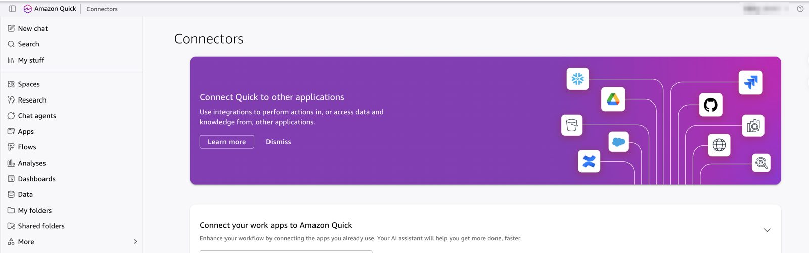
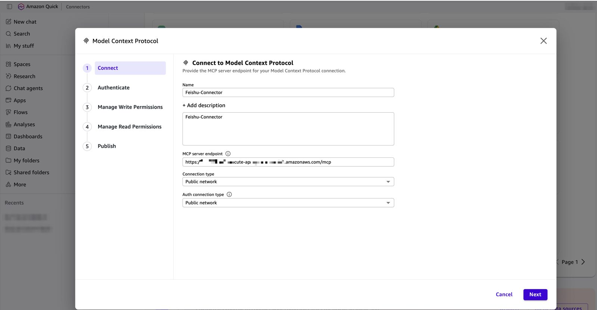
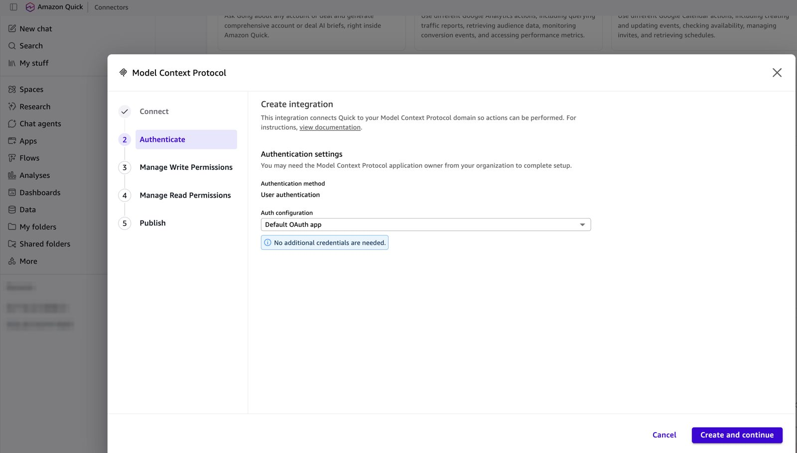
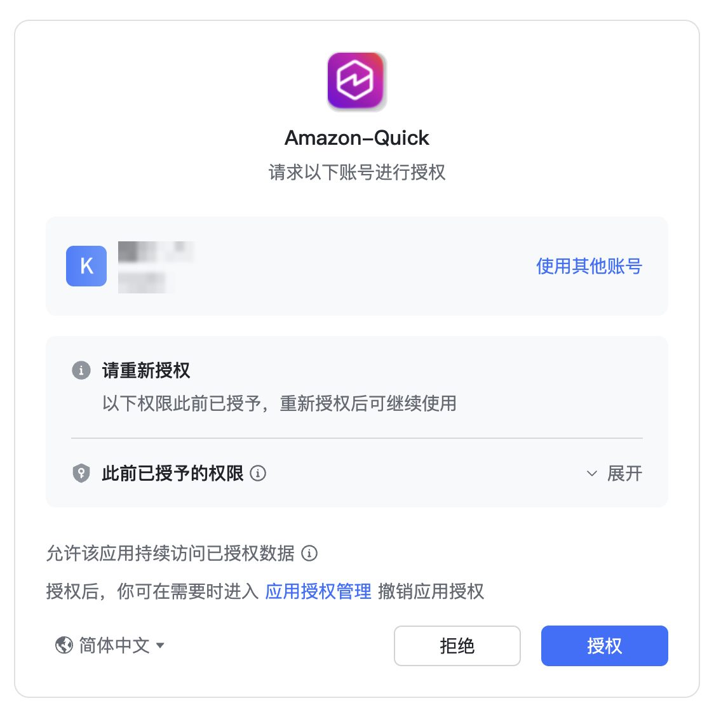
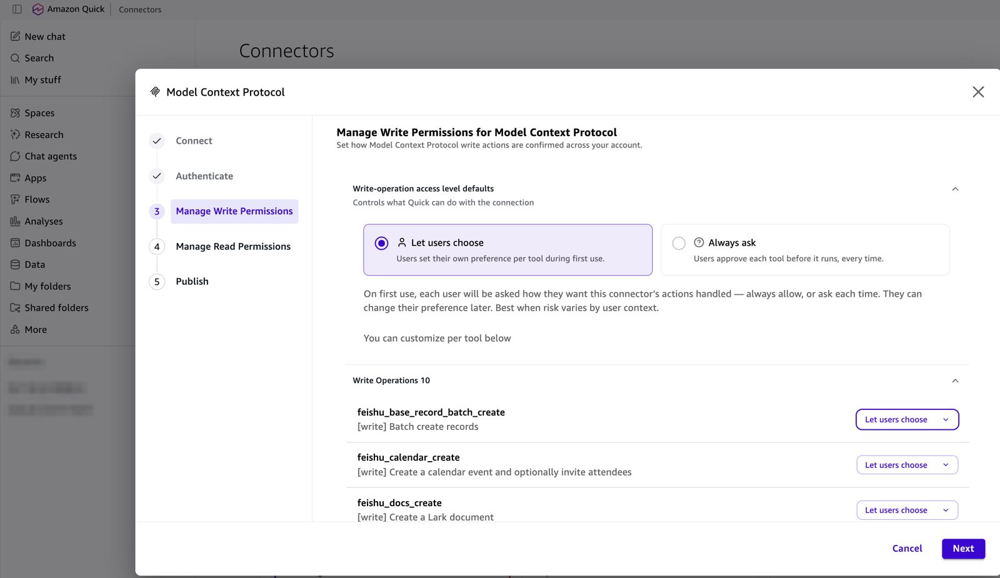
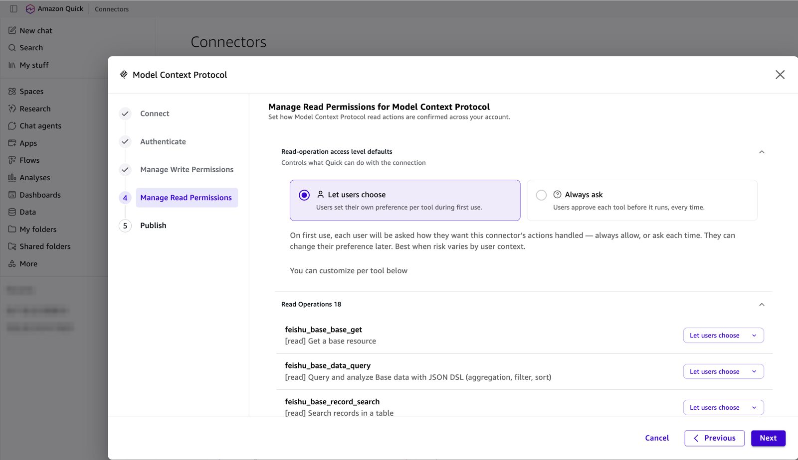
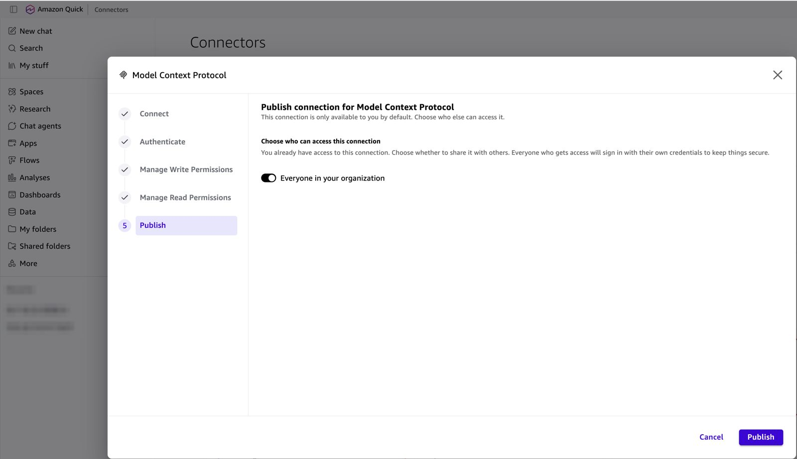
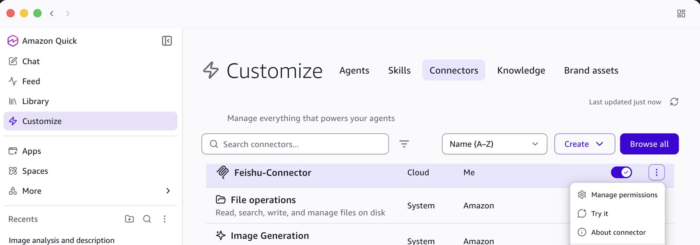
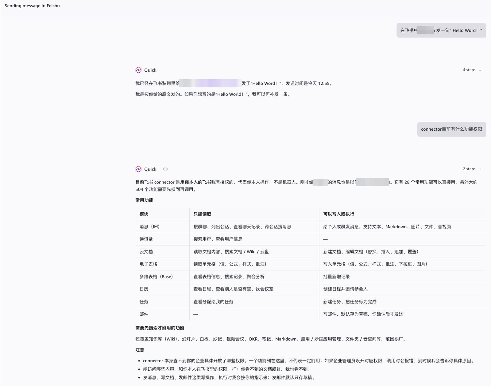

[Chinese](../zh-CN/client-amazon-quick.md) | English

# Connect Amazon Quick (AWS Global regions only)

Amazon Quick connects to this server with **Default OAuth app**: Quick discovers the OAuth metadata and registers itself (Dynamic Client Registration). You only paste the MCP endpoint, and you don't enter a Client ID, secret, or URL.

Amazon Quick is not available in AWS China. In China, use Kiro, Claude Code, Codex, or Cursor ([README](../../README.md#connect-an-mcp-client)).

The screenshots use Feishu. Lark, DingTalk and WeCom work the same way; only the sign-in page in step 4 differs.

## Before you start

| Check | How |
|---|---|
| The stack is deployed | [deploy.md](deploy.md) |
| The IM app secret is stored (Feishu / Lark / DingTalk) | `npm run secret:set-im-app -- -c config=config/deploy.yaml` |
| The stack output `CallbackUrl` is registered in the IM console (Feishu / Lark / DingTalk) | Feishu: [im-setup-feishu.md, step 7](im-setup-feishu.md#7-after-deploy-register-the-callback-url). Without it, sign-in fails (Feishu error **20029**) |
| You have Amazon Quick Enterprise | Quick admin console |

Get the MCP endpoint (stack output `McpUrl`):

```bash
aws cloudformation describe-stacks --stack-name ImMcp-<slug> --region <region> \
  --query "Stacks[0].Outputs[?OutputKey=='McpUrl'].OutputValue" --output text
```

## Step 1: Open Connectors

In Amazon Quick, open **Connectors** (in the web console under **More → Connectors**; in Quick Desktop under **Customize → Connectors → Create**). Choose **Create for your team** → **Model Context Protocol**. If Quick asks about an existing MCP connector, choose **No, create new**.



## Step 2: Connect

| Field | Value |
|---|---|
| Name | For example `Feishu-Connector` |
| Description | Optional |
| MCP server endpoint | The `McpUrl` value (`https://<base>/mcp`) |
| Connection type | **Public network** |
| Auth connection type | **Public network** |

Choose **Next**.



## Step 3: Authenticate with Default OAuth app

**Authentication method** shows **User authentication**. Set **Auth configuration** to **Default OAuth app**. Quick shows "No additional credentials are needed." Choose **Create and continue**.



> Don't choose **Custom user based OAuth**. That option is for servers without dynamic registration and asks for a Client ID, secret, and URLs. If **Default OAuth app** is missing from the list, check the MCP server endpoint (it must end with `/mcp` and return `401` without a token), or see [Fallback](#fallback-custom-user-based-oauth).

## Step 4: Sign in to the IM and authorize

A browser window opens the IM authorization page. Check that it shows your app and your account, then choose **Authorize**. Quick shows "Returning to Quick".



- Feishu / Lark / DingTalk: the IM's own OAuth consent page.
- WeCom: a QR page. Scan it with the WeCom app. If `wecom.requireApproval` is on, the first sign-in waits until an operator runs `npm run users -- approve <userId>`.

## Step 5: Manage write permissions

Quick lists the write tools (10 for Feishu) and asks how write actions are confirmed:

- **Let users choose**: each user picks "always allow" or "ask each time" on first use.
- **Always ask**: users approve each write before it runs. This is recommended for shared organizations.

You can override the setting per tool. Choose **Next**.



## Step 6: Manage read permissions

The same choice for read tools (18 for Feishu). **Let users choose** is usually fine for reads. Choose **Next**.



## Step 7: Publish

The connector is private to you by default. Turn on **Everyone in your organization** to share it. Each person who uses it still signs in with their own IM account the first time. Choose **Publish**.



## Step 8: Use it

The connector appears in **Connectors** (Quick Desktop: **Customize → Connectors**). Make sure its toggle is on. Use **Try it** to test it, or **Manage permissions** to change the read/write confirmation later.



Ask in chat, for example "Send 'Hello World!' to <colleague> in Feishu" or "What can this connector do?". Quick calls the tools as you, the signed-in user, not as a bot.



## How it works

1. `GET <base>/mcp` → `401` with `WWW-Authenticate: Bearer realm="mcp", resource_metadata="<base>/.well-known/oauth-protected-resource"`.
2. Quick reads `<base>/.well-known/oauth-protected-resource` (`scopes_supported: ["mcp", "offline_access"]`) and `<base>/.well-known/oauth-authorization-server` (`registration_endpoint`, `token_endpoint_auth_methods_supported: ["none", "client_secret_post"]`).
3. `POST <base>/register` (DCR). Quick's callback host `*.quicksight.aws.amazon.com` is allowed automatically in AWS Global regions.
4. `GET <base>/authorize` → IM sign-in → `GET <base>/callback` → back to Quick with a code → `POST <base>/token` (PKCE S256).

Quick reads scopes only from the metadata documents (not from the 401 challenge), so both documents declare `mcp` and `offline_access`.

To follow an attempt, read the API access log `/aws/apigateway/im-mcp-<slug>-access`. A complete run shows `GET /mcp 401`, both `.well-known` documents, `POST /register 201`, `GET /authorize 302`, `GET /callback 302`, `POST /token 200`, then `POST /mcp 200`.

## Notes and limits

| Item | Detail |
|---|---|
| Tool count | Quick registers at most 100 tools per connection. This server lists 28–34 (tier 1 plus `<im>_discover` / `<im>_invoke`). |
| Timeout | Quick fails MCP calls after 5 minutes. Tool calls here time out at about 25 seconds. |
| New tools | Custom connectors don't auto-sync. After you upgrade the server, open the connector and choose **Sync**. |
| Missing IM permission | The tool result returns `missing_scope` with an `authorize_url`. Enable the scope in the IM console, publish a new app version, then open the link (or reconnect). Quick doesn't do step-up authorization. |
| Sessions | MCP access tokens last 1 hour; Quick renews them with a rotating refresh token (90 days). The server refreshes the IM token every 30 minutes. |

## Troubleshooting

| Symptom | Cause | Fix |
|---|---|---|
| "Authorization failed. The link has expired or has been used" | A sign-in page was opened twice (refresh or back). Each sign-in link works once. The real error is the first one | Close the page and start again from the connector. If it fails again, read the `oauth` Lambda log for `im_exchange_failed` |
| IM page shows a redirect error (Feishu **20029**) | `CallbackUrl` isn't registered in the IM console | Register it ([Feishu step 7](im-setup-feishu.md#7-after-deploy-register-the-callback-url)) |
| Every tool returns `im_app_not_configured` | The IM app secret was never stored | `npm run secret:set-im-app` |
| "No permission to use the app" on the IM page | The user isn't in the app's availability scope, or the version isn't published | [Feishu steps 4–5](im-setup-feishu.md#4-set-availability) |
| **Default OAuth app** isn't offered | Endpoint wrong, or discovery failed | Check that `curl -i <base>/mcp` returns `401` with `WWW-Authenticate`; otherwise use the fallback |
| `Creation failed` at publish | A tool `inputSchema` is invalid | Report it with the tool name; schemas here are JSON Schema draft 7 |

## Fallback: Custom user based OAuth

Use this only when **Default OAuth app** isn't available. Register a client on the deploy machine:

```bash
npm run register-client -- -c config=config/deploy.yaml
```

It prints `Client ID`, `Client secret`, `Token URL`, `Authorization URL`, and the allowed redirect URLs. It allows the Quick callback in the stack's region and `us-east-1` by default. If the read-only **Redirect URL** in Quick differs, add `--redirect-uri <that URL>`. In Quick choose **Custom user based OAuth**, leave **Public OAuth client** unticked, and paste the values. `--public` registers a public client instead (tick **Public OAuth client**, leave the secret empty).

The client secret is a credential. It is derived from the stack's root key and not stored, so rotating `<slug>/root-key` revokes every client and every MCP token.

Official reference: [MCP integration in Amazon Quick](https://docs.aws.amazon.com/quick/latest/userguide/mcp-integration.html).
