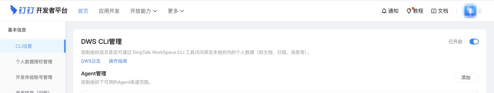
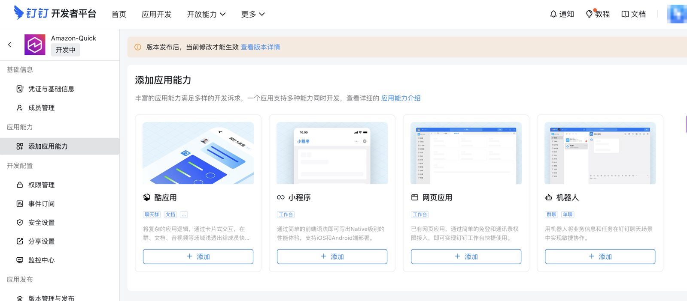
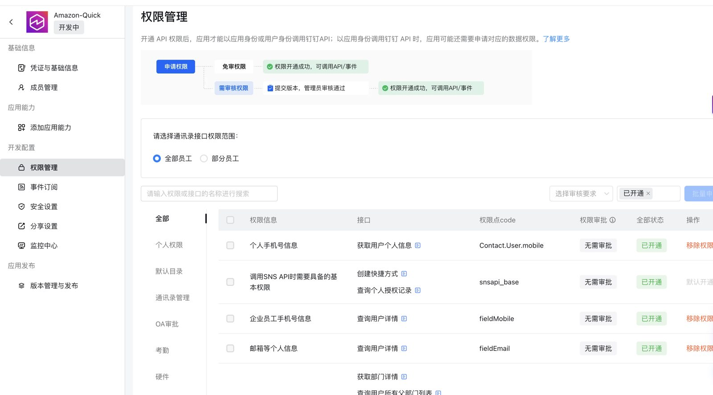
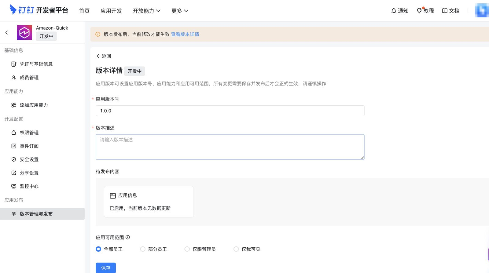
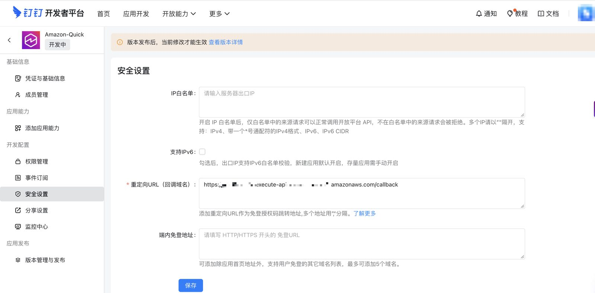

[Chinese](../zh-CN/im-setup-dingtalk.md) | English

# DingTalk app setup (`im: dingtalk`)

The service calls DingTalk through the official `dws` CLI, as each user, with that user's OAuth token. You need:
1. an **internal app** that users authorize through OAuth, and
2. **CLI access enabled** for your organization (an admin action, needed once).

Do steps 1–4 **before** deploying and steps 5–6 **after** the first deploy.

Developer console: https://open-dev.dingtalk.com

## 1. Enable CLI access for the organization (admin)

`dws` is still in DingTalk's co-creation phase: it only works for organizations whose admin has turned it on.

Path: https://open-dev.dingtalk.com → top navigation **More** → **Basic Info** (described as "experience organization and member management") → left menu **CLI Settings** → turn on **DWS CLI Management**.



- One switch for the whole organization. **Agent Management** on the same page controls which agent channels are allowed; the defaults are fine.
- If it is off, tool calls return the error code `im_admin_action_required` (the dws message mentions `cli_not_enabled`, or `user_forbidden` / `user_not_allowed` when the user is excluded). Users may also see **Apply Now**; the admin then gets an approval card and approves with one click.

## 2. Create an internal app

Console → **App Development** → **Internal Apps** → **Create App**. Enter a name, description, and icon.

The app needs no extra capability for this service. **Add App Capability** (Cool App, Mini Program, Web App, Bot) can stay empty, because users sign in through OAuth and all calls go through `dws`.



## 3. Get the Client ID (the secret comes later)

App → **Credentials & Basic Info**:
- **Client ID** (formerly **AppKey** / SuiteKey) → config key `im.dingtalk.clientId`, written in YAML as `dingtalk: { clientId: dingxxxxxxxxxxxx }` (8–64 letters, digits, `_` or `-`).
- **Client Secret** (formerly **AppSecret** / SuiteSecret) → never in the config file. Keep it for step 5.

## 4. Permissions and publish

1. App → **Permission Management**. Set the contacts scope to **All employees** (or the members who should use the service), then search and enable:

   | Permission | Code | Required? | Why |
   |---|---|---|---|
   | Contacts personal info read | `Contact.User.Read` | **Required** | The server reads the signed-in user's own profile (`/v1.0/contact/users/me`) to map their identity. Without it, sign-in fails at the callback with `im_exchange_failed` |
   | Basic permission for SNS APIs | `snsapi_base` | On by default | OAuth sign-in |
   | Personal phone number info | `Contact.User.mobile` | Optional | Phone number in the user's own profile |
   | Employee phone number / email info | `fieldMobile`, `fieldEmail` | Optional | Contact lookups that return phone or email |

   The example below shows several of these enabled; all of them need no approval:

   

   Add more (contacts, calendar, docs, ...) as needed. Some require admin approval. You don't need to map every tool to a permission up front: when a call lacks one, the tool result returns `missing_scope` with `required_scopes` and an `authorize_url`.
2. **Version Management & Release** → create a version: version number (for example `1.0.0`), a description, and **App availability** (all employees, some employees, admins only, or only me). Save and publish. Until then the banner "changes take effect after the version is published" stays, and new permissions or redirect URLs don't apply.

   

Config key `im.dingtalk.scopes`: OAuth scopes requested at authorization. Default `[openid, corpid]`, the same as the official `dws` CLI. `corpid` puts the token in the organization context; leave it in.

## 5. After deploy: store the Client Secret

```bash
npm run secret:set-im-app -- -c config=config/deploy.yaml
```

It prompts for the Client Secret (no echo), validates the pair against DingTalk (`oauth2/accessToken`), and writes Secrets Manager `<slug>/im-app` = `{"appId": "<Client ID>", "appSecret": "<Client Secret>", "configured": true}`. The keys are `appId`/`appSecret` for every IM; for DingTalk `appId` holds the Client ID. On failure it prints `dingtalk rejected the credentials: HTTP …` and stores nothing. `--no-validate` skips the check.

## 6. After deploy: register the redirect URL

Stack output `CallbackUrl` (= `<base>/callback`). `ImConsoleCallbackHint` links to the DingTalk app list.

App → **Security Settings** → **Redirect URL (callback domain)** → paste `CallbackUrl` → **Save**. Leave the IP allowlist empty: the service runs on AgentCore Runtime without a fixed egress IP.



If you change anything on this page or in Permission Management, publish a new version (step 4.2).

Give users the stack output `McpUrl` (= `<base>/mcp`).

## 7. Connect a client

- **Amazon Quick** (AWS Global): follow the [DingTalk walkthrough for Amazon Quick](quick-walkthrough-dingtalk.md) (DingTalk screenshots of every step), or the generic [Amazon Quick tutorial](client-amazon-quick.md). Set **Auth configuration** to **Default OAuth app**; no Client ID is needed.
- **Kiro / Claude Code / Codex / Cursor**: see the [README](../../README.md#connect-an-mcp-client).

## Config and secret mapping

| Value | Where |
|---|---|
| `im: dingtalk` | `config/deploy.yaml` |
| Client ID (AppKey) | `im.dingtalk.clientId` (YAML: `dingtalk: { clientId: ... }`) |
| OAuth scopes | `im.dingtalk.scopes` (default `openid`, `corpid`) |
| Client Secret (AppSecret) | After deploy: `npm run secret:set-im-app` → `<slug>/im-app` `{appId: <Client ID>, appSecret, configured: true}` |
| Redirect URL | Stack output `CallbackUrl` → DingTalk console → Security Settings |
| CLI access | Developer platform → More → Basic Info → CLI Settings (admin) |

## Common errors

| Symptom | Cause | Fix |
|---|---|---|
| Sign-in fails right after DingTalk consent; `oauth` Lambda log shows `im_exchange_failed` with `users_me` | `Contact.User.Read` is not enabled, or the version with it is not published | Step 4, then publish |
| Tool result `im_admin_action_required`, message mentions `cli_not_enabled` | Org has not enabled CLI access | Step 1 (admin): More → Basic Info → CLI Settings |
| Tool result `im_admin_action_required`, message mentions `user_forbidden` | User is not allowed by the org's CLI access policy | Admin approves the user's request or widens the policy |
| Authorization page error about redirect URI | `CallbackUrl` not registered, or a different host (custom domain vs API Gateway URL) | Step 6. Register the exact URL you deployed with |
| Tool result `missing_scope` | App lacks that permission, or the user hasn't granted it | Add the permission (step 4), publish if required, user opens `authorize_url` |
| Tool result `im_reauth_required` | DingTalk rejected the user token (expired or revoked) | User disconnects and reconnects the MCP server |
| Personal (non-org) account gets permission errors | Org-level APIs need an org context | Use an account in the organization |
| `secret:set-im-app` prints `dingtalk rejected the credentials` | Wrong Client ID/Secret pair | Re-run with the right secret |
| Tool result `im_app_not_configured` | Client Secret never stored | Step 5 |

## Capability boundaries

- Acts only as the signed-in user. Messages appear with the user's own name and avatar.
- **CLI access must stay enabled by the org admin.** Disabling it breaks every user.
- The service refreshes DingTalk user tokens server-side every 30 minutes. A user who is inactive for a long period, or whose authorization the admin resets, must re-authorize.
- Commands that start local processes or daemons (for example `dingtalk-tag connect`) and tools that need a local file are marked unavailable.
- DingTalk international (`dingtalk.io`) is not supported in this version.
