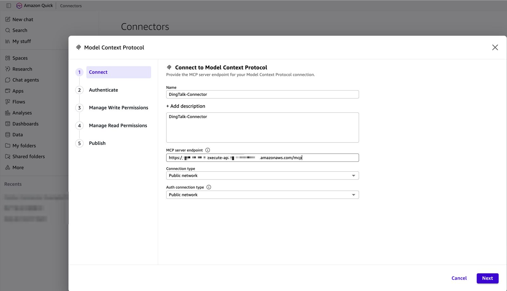
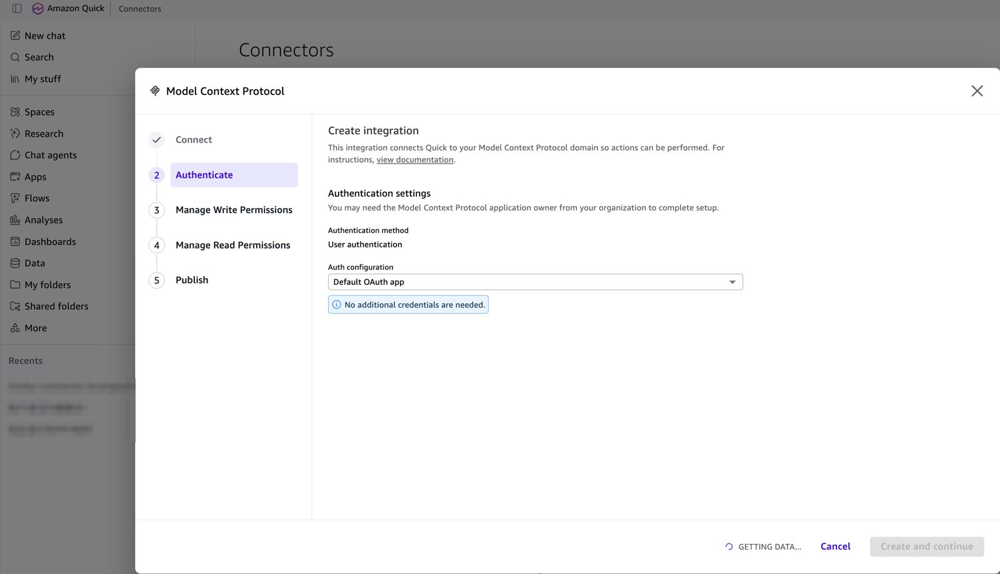
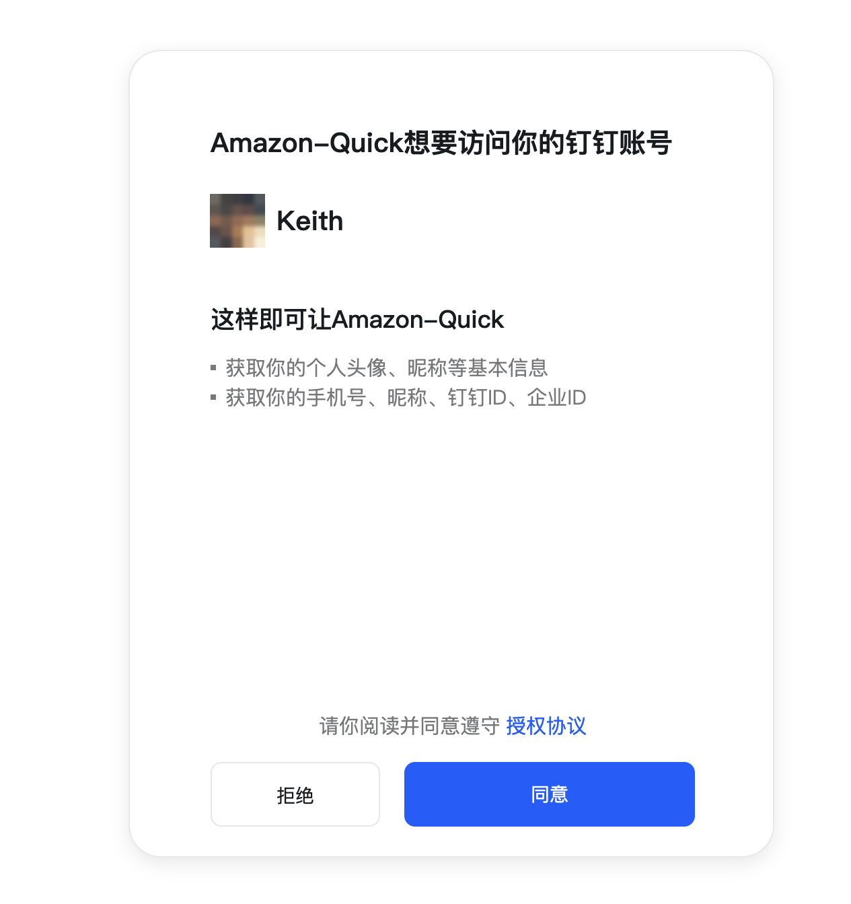
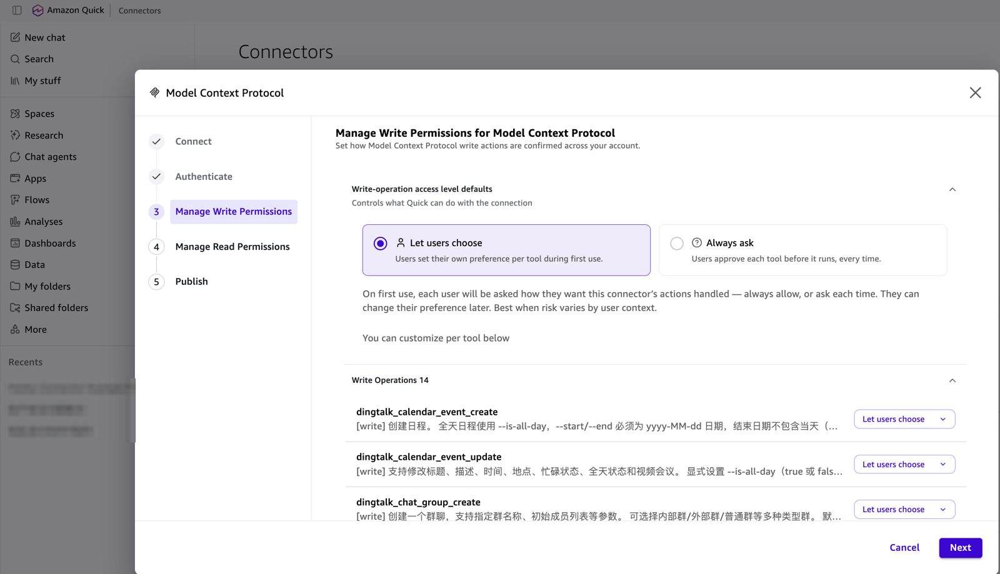
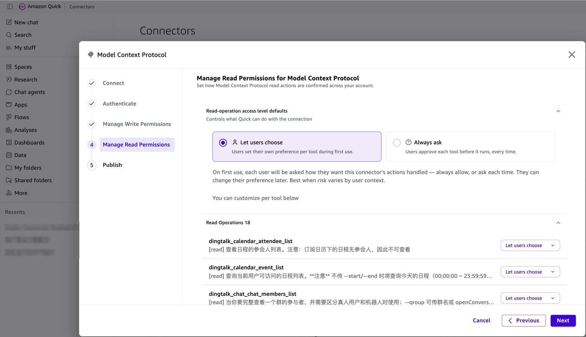
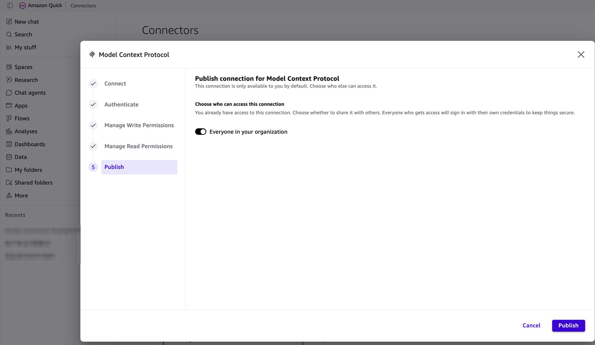
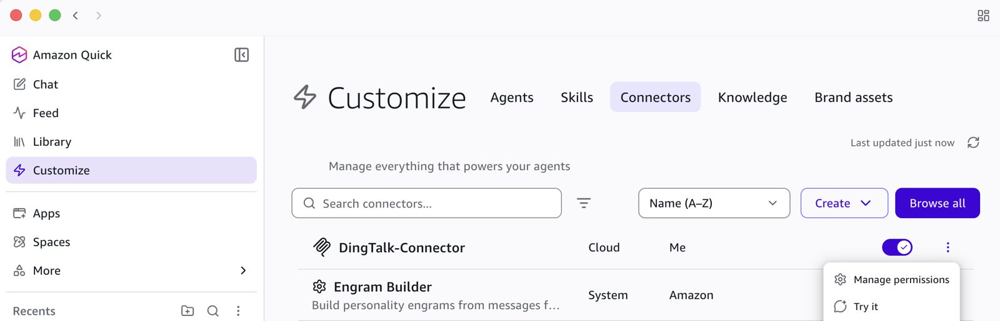
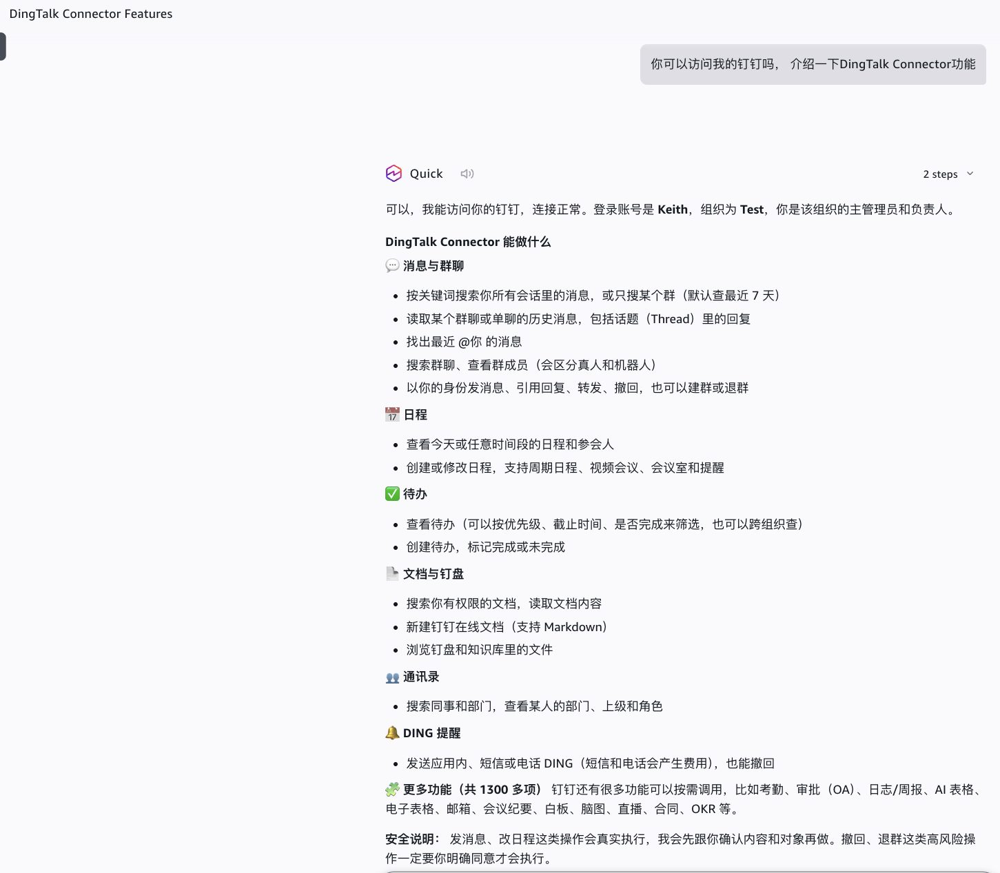

[Chinese](../zh-CN/quick-walkthrough-dingtalk.md) | English

# Amazon Quick + DingTalk walkthrough (Default OAuth app)

This walkthrough connects Amazon Quick to a DingTalk deployment, with screenshots of every step. Quick uses **Default OAuth app**, which means dynamic client registration: you paste the MCP endpoint and enter no Client ID, secret, or URL. For the generic version and the troubleshooting table, see [client-amazon-quick.md](client-amazon-quick.md).

Verified end to end on a real DingTalk organization (ap-southeast-1): `POST /register 201` → `GET /callback 302` → `POST /token 200` → `POST /mcp 200`.

## Before you start

| Check | Where |
|---|---|
| CLI access is on for the organization | [im-setup-dingtalk.md, step 1](im-setup-dingtalk.md#1-enable-cli-access-for-the-organization-admin) |
| `Contact.User.Read` is enabled and the app version is published | [step 4](im-setup-dingtalk.md#4-permissions-and-publish) |
| The Client Secret is stored | [step 5](im-setup-dingtalk.md#5-after-deploy-store-the-client-secret) |
| `CallbackUrl` is registered in Security Settings | [step 6](im-setup-dingtalk.md#6-after-deploy-register-the-redirect-url) |

## 1. Connect

In Amazon Quick open **Connectors** → **Create for your team** → **Model Context Protocol** (choose **No, create new** if asked). Fill in:

| Field | Value |
|---|---|
| Name | For example `DingTalk-Connector` |
| MCP server endpoint | Stack output `McpUrl` (`https://<base>/mcp`) |
| Connection type / Auth connection type | **Public network** |

Choose **Next**.

## 2. Authenticate: Default OAuth app

**Auth configuration** = **Default OAuth app** ("No additional credentials are needed"). Choose **Create and continue**. Quick shows "GETTING DATA..." while it registers itself and opens the sign-in window.

## 3. Authorize in DingTalk

The DingTalk page asks you to let the app access your account: basic profile, phone number, nickname, DingTalk ID, organization ID. Check the account, then choose **Agree**.

## 4. Manage write permissions

Quick lists the DingTalk write tools (14), for example `dingtalk_calendar_event_create` and `dingtalk_chat_group_create`. Choose **Let users choose** or **Always ask** (recommended for shared organizations), optionally per tool. Choose **Next**.

Tool descriptions come from the DingTalk CLI, so they are in Chinese.

## 5. Manage read permissions

The read tools (18), for example `dingtalk_calendar_event_list` and `dingtalk_chat_chat_members_list`. Choose **Next**.

## 6. Publish

Turn on **Everyone in your organization** to share the connector. Each person still signs in with their own DingTalk account the first time. Choose **Publish**.

## 7. Use it

In Quick Desktop, **Customize → Connectors** shows **DingTalk-Connector**. Make sure its toggle is on. Use **Try it**, or **Manage permissions** to change the confirmation settings later.

Ask in chat, for example "Can you access my DingTalk? What can the DingTalk connector do?". Quick answers as the signed-in user and lists messages, calendar, to-dos, docs and drive, contacts, DING, and about 1,300 more commands reachable through `dingtalk_discover` / `dingtalk_invoke`.

## If something fails

| Symptom | Fix |
|---|---|
| DingTalk page shows a redirect error | `CallbackUrl` isn't saved in Security Settings, or the version isn't published ([step 6](im-setup-dingtalk.md#6-after-deploy-register-the-redirect-url)) |
| "Authorization failed. The link has expired or has been used" | The sign-in page was opened twice. Start again from the connector. If it fails again, check the `oauth` Lambda log for `im_exchange_failed` (usually `Contact.User.Read` missing) |
| Tools return `im_admin_action_required` | CLI access is off for the organization ([step 1](im-setup-dingtalk.md#1-enable-cli-access-for-the-organization-admin)) |
| Tools return `missing_scope` | Enable the permission in Permission Management, publish, then open the `authorize_url` from the result |
