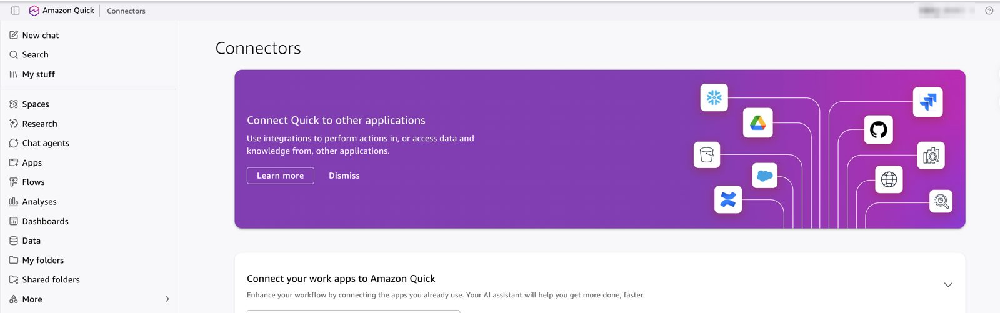
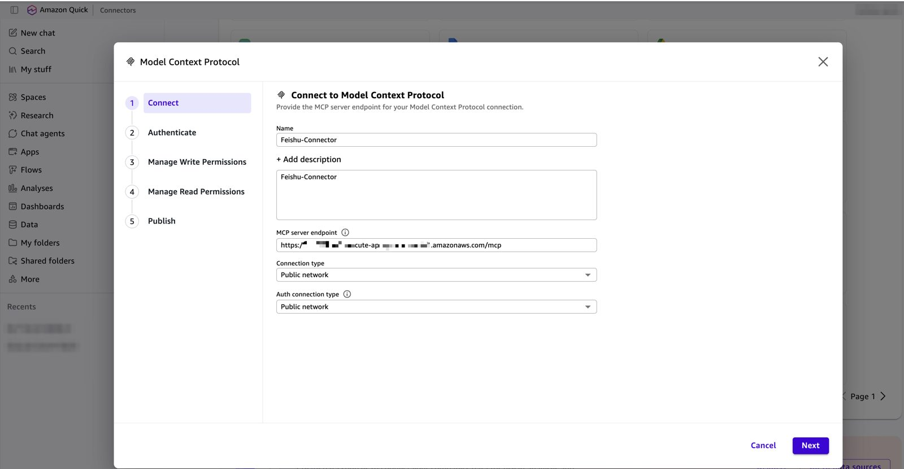
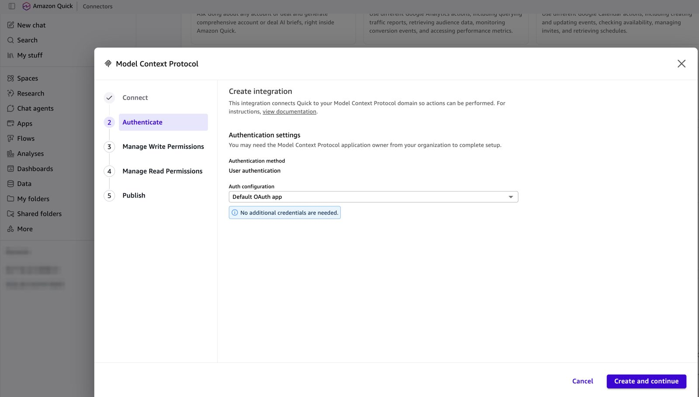
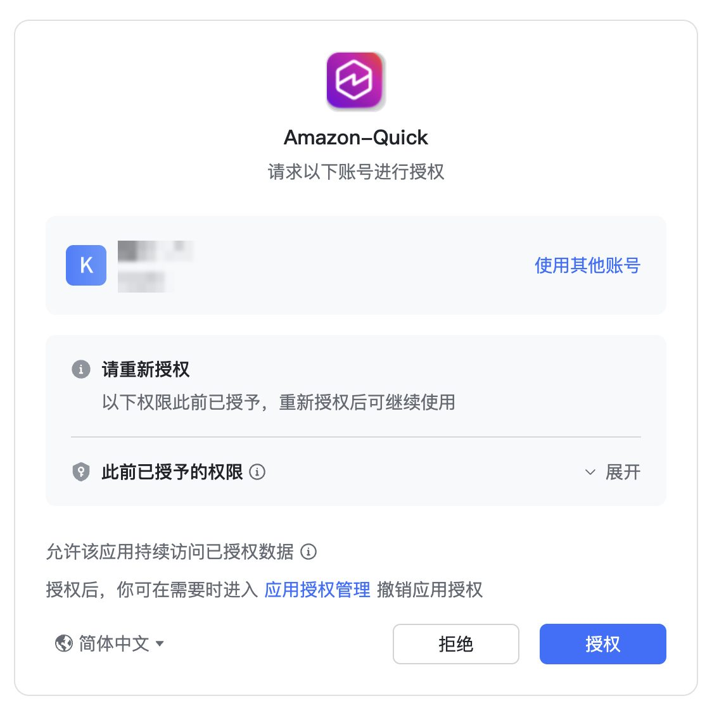
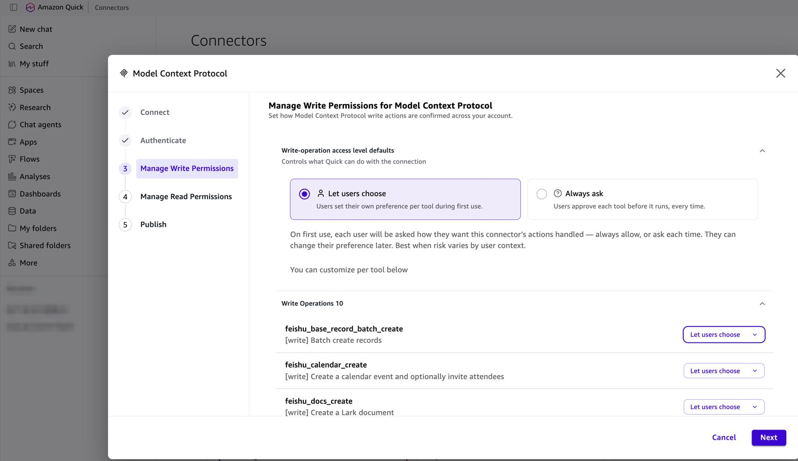
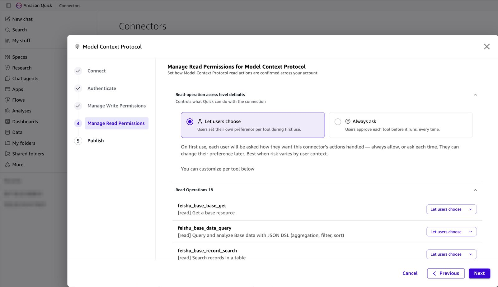
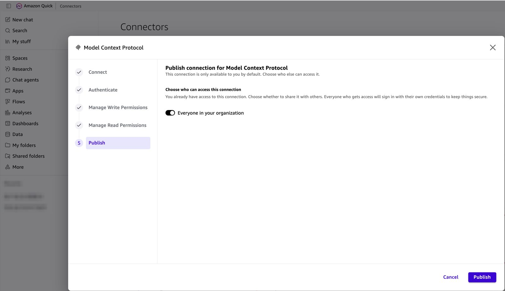
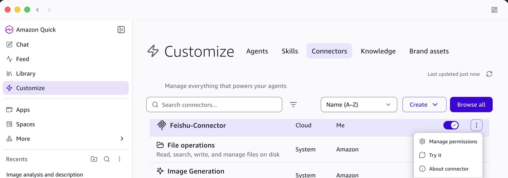
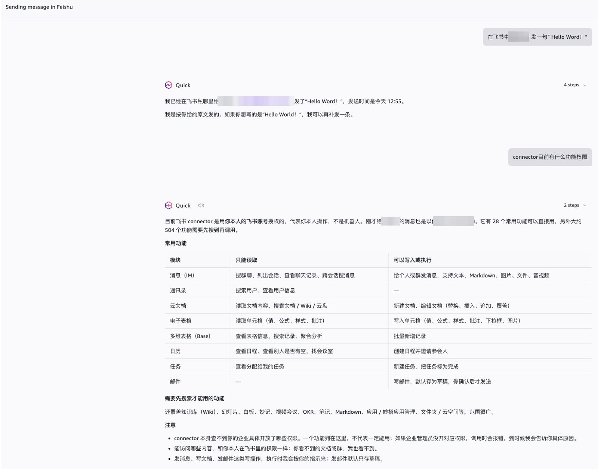

简体中文 | [English](../en/client-amazon-quick.md)

# 接入 Amazon Quick（仅 AWS Global 区域）

Amazon Quick 通过 **Default OAuth app** 接入本服务：Quick 自动发现 OAuth 元数据并自行注册客户端（动态客户端注册，DCR）。你只需要粘贴 MCP 端点，不用填写 Client ID、secret 或任何 URL。

Amazon Quick 在 AWS 中国区不可用。中国区请使用 Kiro、Claude Code、Codex 或 Cursor（见 [README](../../README.zh-CN.md#连接-mcp-客户端)）。

截图以飞书为例。Lark、钉钉、企业微信的流程相同，只有第 4 步的登录页不同。钉钉另有一份带钉钉截图的实操：[quick-walkthrough-dingtalk.md](quick-walkthrough-dingtalk.md)。

## 准备工作

| 检查项 | 方法 |
|---|---|
| Stack 已部署 | [deploy.md](deploy.md) |
| 已写入 IM 应用密钥（飞书 / Lark / 钉钉） | `npm run secret:set-im-app -- -c config=config/deploy.yaml` |
| Stack 输出 `CallbackUrl` 已登记到 IM 后台（飞书 / Lark / 钉钉） | 飞书见 [im-setup-feishu.md 第 7 步](im-setup-feishu.md#7-部署后登记回调-url)。不登记的话登录会失败（飞书错误码 **20029**） |
| 你有 Amazon Quick Enterprise 订阅 | Quick 管理控制台 |

获取 MCP 端点（Stack 输出 `McpUrl`）：

```bash
aws cloudformation describe-stacks --stack-name ImMcp-<slug> --region <region> \
  --query "Stacks[0].Outputs[?OutputKey=='McpUrl'].OutputValue" --output text
```

## 第 1 步：打开 Connectors

在 Amazon Quick 打开 **Connectors**（Web 控制台在 **More → Connectors**；Quick Desktop 在 **Customize → Connectors → Create**）。选择 **Create for your team** → **Model Context Protocol**。如果提示已有 MCP connector，选择 **No, create new**。



## 第 2 步：Connect

| 字段 | 值 |
|---|---|
| Name | 例如 `Feishu-Connector` |
| Description | 可选 |
| MCP server endpoint | `McpUrl` 的值（`https://<base>/mcp`） |
| Connection type | **Public network** |
| Auth connection type | **Public network** |

点击 **Next**。



## 第 3 步：认证选择 Default OAuth app

**Authentication method** 显示 **User authentication**。把 **Auth configuration** 设为 **Default OAuth app**，页面会提示 "No additional credentials are needed."，点击 **Create and continue**。



> 不要选 **Custom user based OAuth**。那个选项是给不支持动态注册的服务器用的，会要求填写 Client ID、secret 和 URL。如果下拉框里没有 **Default OAuth app**，请检查 MCP server endpoint（必须以 `/mcp` 结尾，并且无 token 时返回 `401`），或参考下文的[备选方案](#备选方案custom-user-based-oauth)。

## 第 4 步：登录 IM 并授权

浏览器会打开 IM 授权页。确认显示的是你的应用和你本人的账号，点击**授权**，页面随后显示 "Returning to Quick"。



- 飞书 / Lark / 钉钉：IM 自己的 OAuth 授权页。
- 企业微信：扫码页，用企业微信 App 扫码。如果开启了 `wecom.requireApproval`，首次登录需要等运维执行 `npm run users -- approve <userId>` 之后才能使用。

## 第 5 步：管理写权限

Quick 列出写操作工具（飞书为 10 个），并让你设置写操作的确认方式：

- **Let users choose**：每个用户首次使用时自己选择"总是允许"或"每次询问"。
- **Always ask**：每次写操作执行前都需要用户确认。组织内共享使用时推荐这个选项。

也可以针对单个工具单独设置。点击 **Next**。



## 第 6 步：管理读权限

读操作工具（飞书为 18 个）的设置方式相同，读操作一般选 **Let users choose** 即可。点击 **Next**。



## 第 7 步：发布

connector 默认只有你自己可以使用。打开 **Everyone in your organization** 即可共享给组织内所有人。每个使用者第一次使用时仍然要用自己的 IM 账号登录。点击 **Publish**。



## 第 8 步：使用

connector 会出现在 **Connectors** 中（Quick Desktop：**Customize → Connectors**），确认开关已打开。可以用 **Try it** 测试，或通过 **Manage permissions** 修改读写确认方式。



在对话中直接提问，例如"在飞书里给<同事>发一句 Hello World!"或"这个 connector 有什么功能？"。Quick 会以你本人（已登录用户）的身份调用工具，而不是以机器人身份。



## 工作原理

1. `GET <base>/mcp` → `401`，响应头 `WWW-Authenticate: Bearer realm="mcp", resource_metadata="<base>/.well-known/oauth-protected-resource"`。
2. Quick 读取 `<base>/.well-known/oauth-protected-resource`（`scopes_supported: ["mcp", "offline_access"]`）和 `<base>/.well-known/oauth-authorization-server`（`registration_endpoint`、`token_endpoint_auth_methods_supported: ["none", "client_secret_post"]`）。
3. `POST <base>/register`（DCR）。Quick 的回调域名 `*.quicksight.aws.amazon.com` 在 AWS Global 区域默认放行。
4. `GET <base>/authorize` → IM 登录 → `GET <base>/callback` → 带授权码回到 Quick → `POST <base>/token`（PKCE S256）。

Quick 只从元数据文档读取 scope（不读 401 响应里的 scope），因此两份文档都声明了 `mcp` 和 `offline_access`。

排查时可以查看 API 访问日志 `/aws/apigateway/im-mcp-<slug>-access`。一次完整的接入依次是：`GET /mcp 401`、两份 `.well-known` 文档、`POST /register 201`、`GET /authorize 302`、`GET /callback 302`、`POST /token 200`，然后是 `POST /mcp 200`。

## 说明与限制

| 项目 | 说明 |
|---|---|
| 工具数量 | Quick 每个连接最多注册 100 个工具。本服务列出 28–34 个（tier 1 加 `<im>_discover` / `<im>_invoke`）。 |
| 超时 | Quick 的 MCP 调用 5 分钟超时。本服务的工具调用约 25 秒超时。 |
| 新工具 | 自定义 connector 不会自动同步。升级服务端后，打开 connector 点击 **Sync**。 |
| 缺少 IM 权限 | 工具结果返回 `missing_scope` 和 `authorize_url`。在 IM 后台开通权限、发布新版本后，打开该链接（或重新连接）。Quick 本身不支持增量授权。 |
| 会话 | MCP access token 有效期 1 小时，Quick 用轮换的 refresh token（90 天）续期。服务端每 30 分钟刷新一次 IM token。 |

## 常见问题

| 现象 | 原因 | 处理 |
|---|---|---|
| "授权失败，链接已过期或已被使用" | 登录页被打开了两次（刷新或返回）。每个登录链接只能用一次，真正的错误是第一次那个 | 关闭页面，从 connector 重新发起。如果再次失败，查看 `oauth` Lambda 日志中的 `im_exchange_failed` |
| IM 页面提示重定向错误（飞书 **20029**） | IM 后台未登记 `CallbackUrl` | 登记回调地址（[飞书第 7 步](im-setup-feishu.md#7-部署后登记回调-url)） |
| 所有工具都返回 `im_app_not_configured` | 从未写入 IM 应用密钥 | 执行 `npm run secret:set-im-app` |
| IM 页面提示"无权限使用该应用" | 用户不在应用的可用范围内，或版本未发布 | [飞书第 4–5 步](im-setup-feishu.md#4-设置可用范围) |
| 下拉框里没有 **Default OAuth app** | 端点填错，或元数据发现失败 | 确认 `curl -i <base>/mcp` 返回 `401` 并带 `WWW-Authenticate`；否则使用备选方案 |
| 发布时提示 `Creation failed` | 某个工具的 `inputSchema` 不合法 | 带上工具名提 issue；本服务的 schema 为 JSON Schema draft 7 |

## 备选方案：Custom user based OAuth

只有在没有 **Default OAuth app** 选项时才使用。在部署机上注册一个客户端：

```bash
npm run register-client -- -c config=config/deploy.yaml
```

脚本会输出 `Client ID`、`Client secret`、`Token URL`、`Authorization URL` 和允许的回调地址，默认放行 Stack 所在区域和 `us-east-1` 的 Quick 回调地址。如果 Quick 中只读的 **Redirect URL** 与之不同，加上 `--redirect-uri <该地址>` 重新执行。在 Quick 中选择 **Custom user based OAuth**，不要勾选 **Public OAuth client**，然后粘贴这些值。`--public` 会注册公共客户端（勾选 **Public OAuth client**，secret 留空）。

Client secret 属于凭证。它由 Stack 的根密钥派生，服务端不保存；轮换 `<slug>/root-key` 会使所有客户端和所有 MCP token 失效。

官方文档：[MCP integration in Amazon Quick](https://docs.aws.amazon.com/quick/latest/userguide/mcp-integration.html)。
