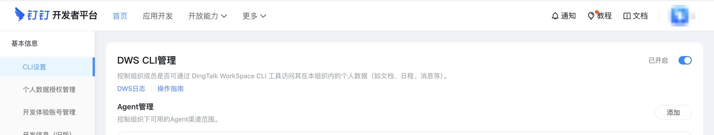
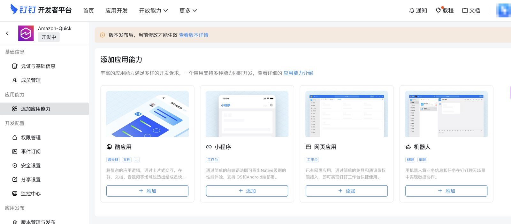
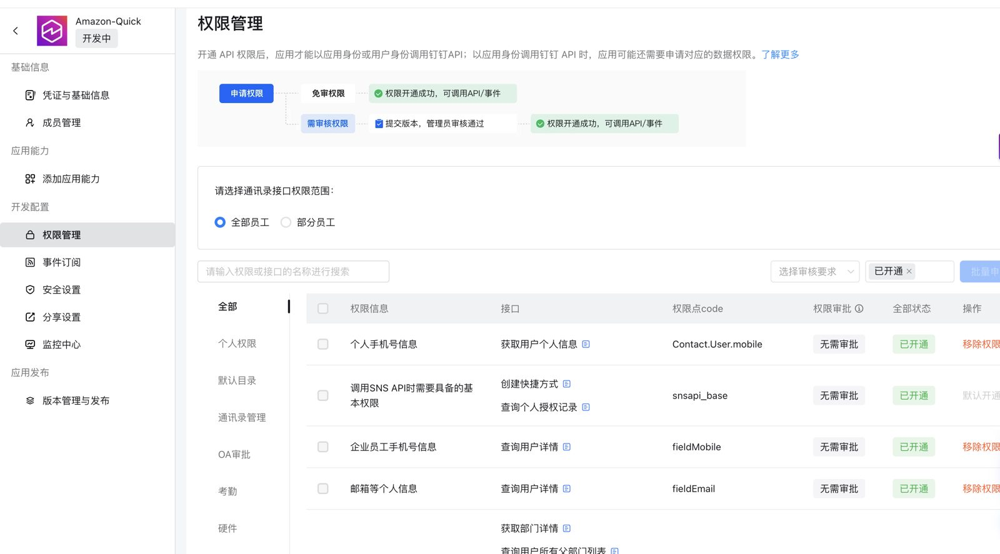

简体中文 | [English](../en/im-setup-dingtalk.md)

# 钉钉应用配置（`im: dingtalk`）

服务通过钉钉官方 `dws` CLI，以每个用户自己的身份、使用该用户的 OAuth token 调用钉钉。你需要准备：
1. 一个供用户做 OAuth 授权的**企业内部应用**；
2. 为组织**开通 CLI 访问**（管理员操作，只需一次）。

第 1–4 步在**部署前**完成，第 5–6 步在**首次部署后**完成。

开发者后台：https://open-dev.dingtalk.com

## 1. 为组织开通 CLI 访问（管理员）

`dws` 目前仍处于钉钉的"共创阶段"：只有管理员开通后，组织成员才能使用。

路径：https://open-dev.dingtalk.com → 顶部导航 **更多** → **基本信息**（说明文字为"体验组织与人员管理"）→ 左侧菜单 **CLI设置** → 打开 **DWS CLI管理**。



- 一个开关对整个组织生效。同一页的 **Agent管理** 控制组织可用的 Agent 渠道，保持默认即可。
- 未开启时，工具调用返回错误码 `im_admin_action_required`（dws 的错误信息中，组织未开通时包含 `cli_not_enabled`，用户被排除时包含 `user_forbidden` / `user_not_allowed`）。用户也可能看到**立即申请**的提示，之后管理员会收到审批卡片，一键即可通过。

## 2. 创建企业内部应用

后台 → **应用开发** → **企业内部应用** → **创建应用**，填写名称、描述和图标。

本服务不需要额外的应用能力。**添加应用能力**（酷应用、小程序、网页应用、机器人）可以都不添加：用户通过 OAuth 登录，所有调用都经过 `dws`。



## 3. 获取 Client ID（密钥稍后再填）

应用 → **凭证与基础信息**：
- **Client ID**（原 **AppKey** / SuiteKey）→ 配置项 `im.dingtalk.clientId`，YAML 中写作 `dingtalk: { clientId: dingxxxxxxxxxxxx }`（8–64 位字母、数字、`_` 或 `-`）。
- **Client Secret**（原 **AppSecret** / SuiteSecret）→ 不写进配置文件，留到第 5 步使用。

## 4. 申请权限并发布

1. 应用 → **权限管理**。通讯录接口权限范围选择**全部员工**（或需要使用本服务的成员），然后搜索并开通：

   | 权限 | 权限点 code | 是否必需 | 用途 |
   |---|---|---|---|
   | 通讯录个人信息读权限 | `Contact.User.Read` | **必需** | 服务端读取登录用户本人的资料（`/v1.0/contact/users/me`）来映射身份。未开通时，回调阶段会报 `im_exchange_failed`，登录失败 |
   | 调用 SNS API 时需要具备的基本权限 | `snsapi_base` | 默认开通 | OAuth 登录 |
   | 个人手机号信息 | `Contact.User.mobile` | 可选 | 用户本人资料中的手机号 |
   | 企业员工手机号 / 邮箱等个人信息 | `fieldMobile`、`fieldEmail` | 可选 | 返回手机号或邮箱的通讯录查询 |

   下图是部分权限开通后的示例，这几项都无需审批：

   

   通讯录、日程、文档等权限按需添加，其中部分需要管理员审批。不必事先把每个工具都对应到权限：调用缺少权限时，工具结果会返回 `missing_scope`，附带 `required_scopes` 和 `authorize_url`。
2. **版本管理与发布** → 创建并发布版本。上线后，"版本发布后，当前修改才能生效"的提示会消失。把可见范围限定为需要使用本服务的用户。

配置项 `im.dingtalk.scopes`：授权时申请的 OAuth scope，默认 `[openid, corpid]`，与官方 `dws` CLI 一致。`corpid` 让 token 带上组织上下文，请保留。

## 5. 部署后：写入 Client Secret

```bash
npm run secret:set-im-app -- -c config=config/deploy.yaml
```

脚本提示输入 Client Secret（不回显），向钉钉校验这一对凭证（`oauth2/accessToken`），然后写入 Secrets Manager `<slug>/im-app` = `{"appId": "<Client ID>", "appSecret": "<Client Secret>", "configured": true}`。所有 IM 的字段名都是 `appId`/`appSecret`，钉钉的 `appId` 存放的就是 Client ID。校验失败时打印 `dingtalk rejected the credentials: HTTP …`，不写入任何内容。`--no-validate` 可跳过校验。

## 6. 部署后：登记重定向 URL

Stack 输出 `CallbackUrl`（= `<base>/callback`）。`ImConsoleCallbackHint` 是钉钉应用列表的链接。

应用 → **安全设置** → **重定向 URL**（部分控制台版本叫"回调域名"）→ 添加 `CallbackUrl` → 保存（以控制台为准，界面可能变化）。

把 Stack 输出 `McpUrl`（= `<base>/mcp`）发给用户。

## 7. 接入客户端

- **Amazon Quick**（AWS Global）：见 [client-amazon-quick.md](client-amazon-quick.md)，选择 **Default OAuth app**。只有第 4 步的登录页是钉钉的。
- **Kiro / Claude Code / Codex / Cursor**：见 [README](../../README.zh-CN.md#连接-mcp-客户端)。

## 配置与密钥对照

| 值 | 位置 |
|---|---|
| `im: dingtalk` | `config/deploy.yaml` |
| Client ID（AppKey） | `im.dingtalk.clientId`（YAML：`dingtalk: { clientId: ... }`） |
| OAuth scope | `im.dingtalk.scopes`（默认 `openid`、`corpid`） |
| Client Secret（AppSecret） | 部署后：`npm run secret:set-im-app` → `<slug>/im-app` `{appId: <Client ID>, appSecret, configured: true}` |
| 重定向 URL | Stack 输出 `CallbackUrl` → 钉钉后台 → 安全设置 |
| CLI 访问 | 开发者平台 → 更多 → 基本信息 → CLI设置（管理员） |

## 常见错误

| 现象 | 原因 | 处理 |
|---|---|---|
| 钉钉授权后立即登录失败，`oauth` Lambda 日志显示 `im_exchange_failed`（`users_me`） | 未开通 `Contact.User.Read`，或包含该权限的版本未发布 | 第 4 步，然后发布 |
| 工具结果返回 `im_admin_action_required`，信息中包含 `cli_not_enabled` | 组织没有开通 CLI 访问 | 第 1 步（管理员）：更多 → 基本信息 → CLI设置 |
| 工具结果返回 `im_admin_action_required`，信息中包含 `user_forbidden` | 组织的 CLI 访问策略不允许该用户 | 管理员审批该用户的申请，或放宽策略 |
| 授权页提示重定向 URI 错误 | `CallbackUrl` 没有登记，或登记的主机不一致（自定义域名和 API Gateway URL 混用） | 第 6 步，登记与部署时完全一致的 URL |
| 工具结果返回 `missing_scope` | 应用缺少该权限，或用户没有授予 | 补充权限（第 4 步），必要时重新发布，用户打开 `authorize_url` |
| 工具结果返回 `im_reauth_required` | 钉钉拒绝了用户 token（过期或被撤销） | 用户断开并重新连接 MCP 服务器 |
| 个人账号（非组织）调用报权限错误 | 组织级接口需要组织上下文 | 使用组织内的账号 |
| `secret:set-im-app` 打印 `dingtalk rejected the credentials` | Client ID/Secret 不是同一对 | 用正确的密钥重新执行 |
| 工具结果返回 `im_app_not_configured` | 从未写入 Client Secret | 第 5 步 |

## 能力边界

- 只以已登录用户的身份操作，消息显示用户本人的头像和昵称。
- **CLI 访问必须由组织管理员保持开通**，关闭后所有用户都无法使用。
- 服务端每 30 分钟自动刷新钉钉用户 token。用户长时间不使用，或管理员重置了其授权时，需要重新授权。
- 会启动本地进程或守护进程的命令（例如 `dingtalk-tag connect`）以及需要本地文件的工具标记为不可用。
- 本版本不支持钉钉国际版（`dingtalk.io`）。
