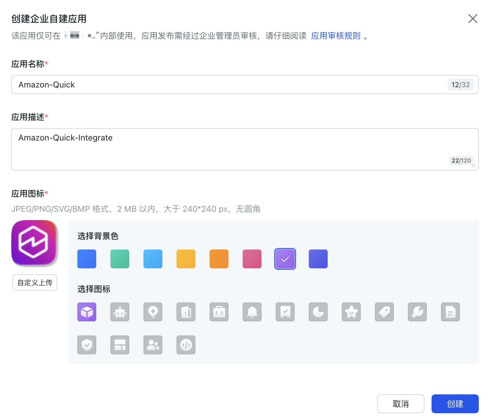
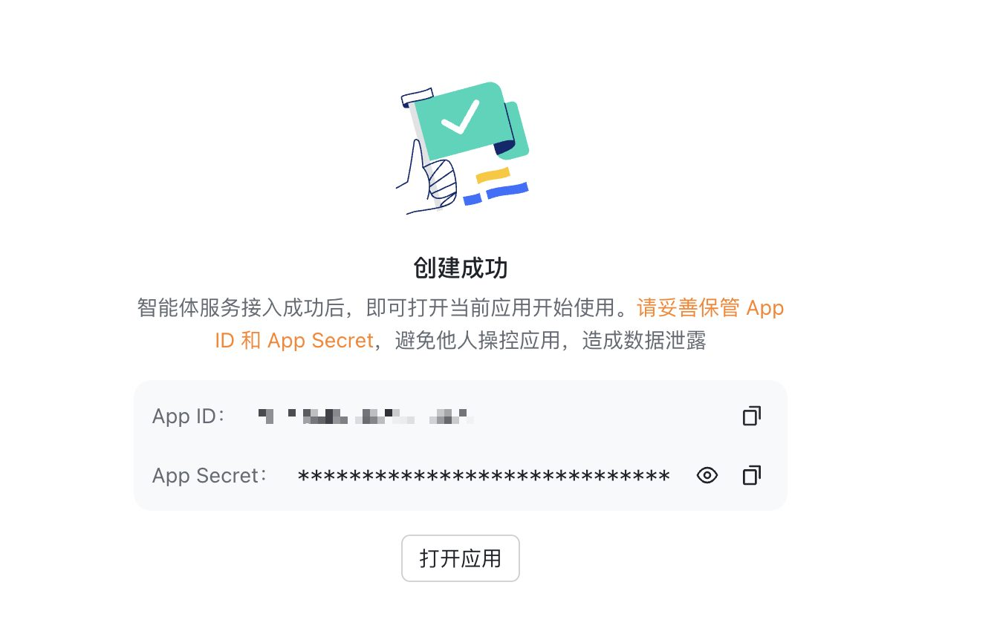
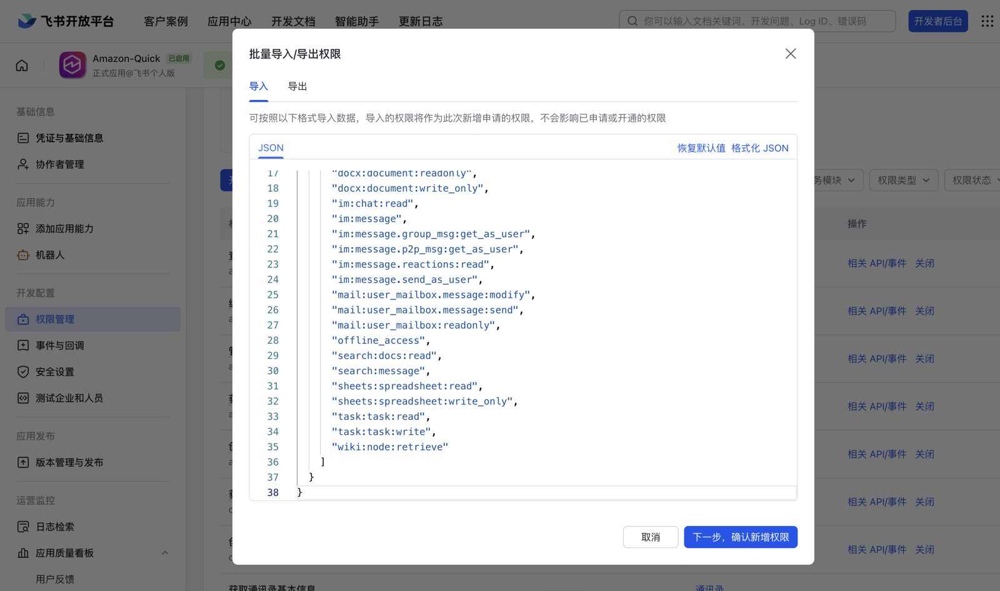
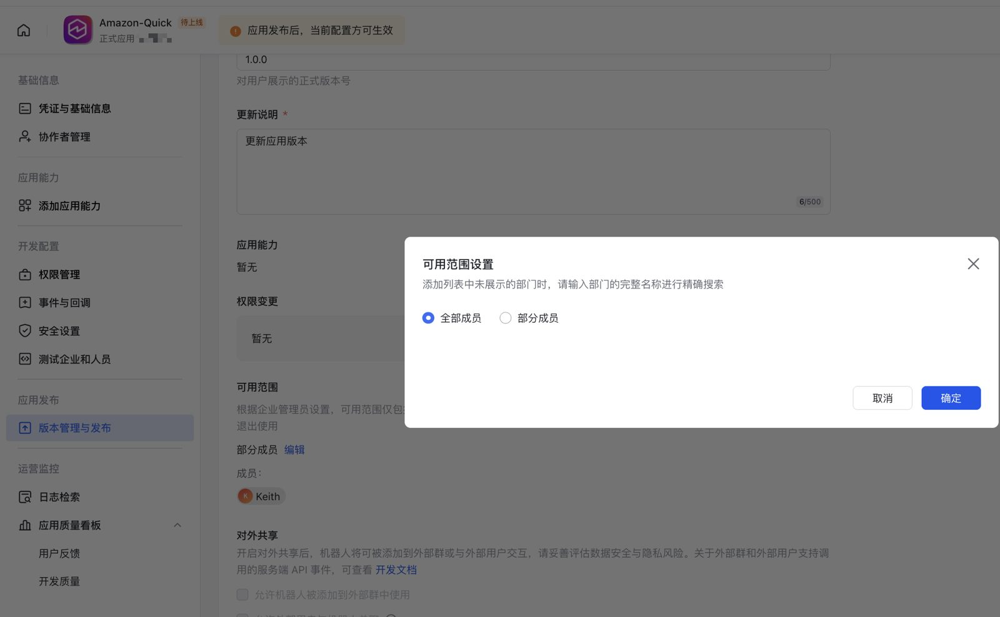
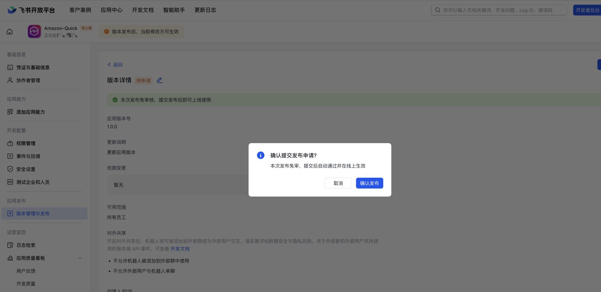
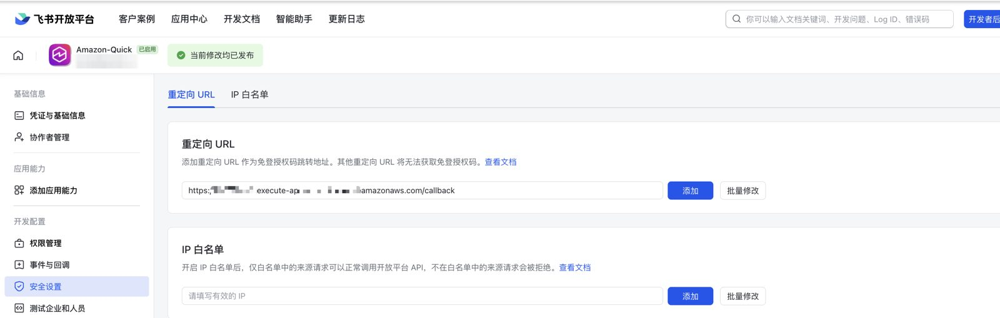

简体中文 | [English](../en/im-setup-feishu.md)

# 飞书应用配置（`im: feishu`）

飞书（国内版，open.feishu.cn）与 Lark（国际版，open.larksuite.com）是**两个独立的平台**，在一个平台创建的应用不能在另一个平台使用。如果你的租户在 Lark 上，请看 [im-setup-lark.md](im-setup-lark.md)。

部署不会替你创建应用。第 1–5 步在**部署前**完成，第 6–7 步在**首次部署后**完成：第 6 步要写入的密钥由部署创建，第 7 步的回调 URL 也要等 Stack 部署出来才有。

开发者后台：https://open.feishu.cn/app

## 1. 创建企业自建应用

1. 用租户内有权限创建应用的账号登录开发者后台。
2. 点击**创建企业自建应用**，填写名称、描述和图标，点击**创建**。



## 2. 获取 App ID（密钥稍后再填）

应用 → **凭证与基础信息**：
- **App ID**（`cli_` 加 8–32 位字母数字）→ 配置项 `im.feishu.appId`，YAML 中写作 `feishu: { appId: cli_xxxxxxxxxxxxxxxx }`。
- **App Secret** → **不要**写进配置文件，留到第 6 步使用。

应用创建成功后，页面会直接显示这两个值，请妥善保存：



## 3. 开通权限

应用 → **权限管理** → **批量导入/导出**（以控制台为准，界面可能变化）→ 粘贴 scope JSON。



- 使用仓库中生成好的列表 [`config/scopes/feishu.json`](../../config/scopes/feishu.json)。格式为 `{"scopes": {"tenant": [], "user": [...]}}`，覆盖 tier-1 工具和 `offline_access`。它由 `npm run gen:catalog` 根据固定版本的 `lark-cli` 生成，与服务端实际提供的工具保持一致，可以直接粘贴到批量导入中。
- 本项目**只使用用户身份**，所有 scope 都在 `user` 下，`tenant` 留空。
- **建议一次性开通所有可能用到的权限。** 用户只能授予控制台里已经开通的权限。
- **必须开通 `offline_access`**：服务端需要 refresh token 才能持续刷新用户 token。
- tier-1 以外的工具（通过 `feishu_invoke` 调用）可能需要更多权限。调用缺少权限时，工具结果会返回 `missing_scope` 和所需的 scope 名称；开通这些权限并发布新版本后，让用户打开结果中的链接即可。

配置项 `im.feishu.scopes`：授权时申请的 scope。**默认（不设置时）：`config/scopes/feishu.json` 中的全部 `user` scope**（目前 31 个）。如果希望首次登录时申请更少的权限，可以设置一个较短的列表；之后需要更多权限的工具会返回 `missing_scope` 和增量授权链接（`authorize_url`）。

## 4. 设置可用范围

应用 → **可用范围**：限定为需要使用本服务的部门或成员。**只有可用范围内的成员才能完成授权。**决定谁能接入的是可用范围，而不是任何密钥。

可用范围在创建版本（第 5 步）时设置，可选**全部成员**或**部分成员**：



## 5. 发布版本

应用 → **版本管理与发布** → 创建版本 → 提交，由租户管理员审批。**之后每次修改权限都要重新发布版本。**

如果本次发布免审（例如个人版或测试租户），确认后即自动上线：



## 6. 部署后：写入 App Secret

```bash
npm run secret:set-im-app -- -c config=config/deploy.yaml
```

脚本会提示输入 App Secret（不回显，也可以从 stdin 读取），先向飞书校验（`app_access_token`），再写入 Secrets Manager `<slug>/im-app` = `{"appId": "...", "appSecret": "...", "configured": true}`。校验失败时会打印 `feishu rejected the credentials: code=… msg=…`，不写入任何内容。`--no-validate` 可以跳过校验（例如所在网络无法访问 open.feishu.cn）。Lambda 会在 5 分钟内读到新值，容器在 30 分钟内读到。

## 7. 部署后：登记回调 URL

部署会输出 Stack 输出 `CallbackUrl`（= `<base>/callback`）和 `ImConsoleCallbackHint`（直达该应用安全设置页面的链接）。`<base>` 即 Stack 输出 `BaseUrl`：`https://<ingress.customDomain>`；`ingress.edge: cloudfront` 时为 CloudFront 域名；否则为 API Gateway URL。

应用 → **安全设置** → **重定向 URL** → 粘贴 `CallbackUrl` → **添加**。



- 填写完整路径，查询参数（`?…`）和锚点（`#…`）不用填。
- 之后如果新增或更改了 `ingress.customDomain` 或 `ingress.edge`，也要登记新的回调 URL。

然后把 MCP 端点，即 Stack 输出 `McpUrl`（= `<base>/mcp`），发给用户。

## 8. 接入客户端

- **Amazon Quick**（AWS Global）：见 [client-amazon-quick.md](client-amazon-quick.md)。选择 **Default OAuth app**，不需要 Client ID。每个 Quick 界面都有飞书示例截图。
- **Kiro / Claude Code / Codex / Cursor**：添加 `McpUrl`，见 [README](../../README.zh-CN.md#连接-mcp-客户端)。

## 配置与密钥对照

| 值 | 位置 |
|---|---|
| `im: feishu` | `config/deploy.yaml` |
| App ID | `im.feishu.appId`（YAML：`feishu: { appId: ... }`） |
| 授权 scope | `im.feishu.scopes`（列表；默认为 `config/scopes/feishu.json` 的 `scopes.user`） |
| App Secret | 部署后：`npm run secret:set-im-app` → Secrets Manager `<slug>/im-app` `{appId, appSecret, configured: true}` |
| 回调 URL | Stack 输出 `CallbackUrl` → 飞书后台 → 安全设置 → 重定向 URL |

## 常见错误

| 现象 | 原因 | 处理 |
|---|---|---|
| 授权页报 **20029**，或返回 `redirect_uri unmatch` | 回调 URL 没有登记，或登记在了错误的平台（Lark 而不是飞书） | 执行第 7 步，逐字核对 URL，包括 `https://` 和 `/callback` |
| 用户无法授权 / 提示"无权使用该应用" | 用户不在**可用范围**内，或版本还没审批通过 | 第 4–5 步 |
| 工具结果返回 `missing_scope` | 控制台没开通该权限，或用户从未授予过 | 开通权限并发布新版本，用户打开工具结果里的 `authorize_url`（或重新连接） |
| `secret:set-im-app` 打印 `feishu rejected the credentials` | App ID / App Secret 填错，或应用是在 Lark 上创建的 | 用正确的密钥重新执行，并确认 `im` 与平台一致 |
| `secret:set-im-app` 报 `ResourceNotFoundException` | 在首次部署之前执行了 | 先部署，再执行 |
| 工具结果返回 `im_app_not_configured` | 从未写入 App Secret（密钥仍是占位值） | 第 6 步 |
| 用了几天后会话失效 | 没开通 `offline_access`，拿不到 refresh token | 开通并发布，用户重新连接 |

## 能力边界

- 只以已登录用户的身份操作，不提供机器人消息、群发或事件订阅。
- 权限变更要等新版本发布**并且**用户授予新权限后，才会对已接入的用户生效。
- 飞书应用不能服务 Lark 租户，反之亦然。
- 需要服务端本地文件的工具（从某个路径上传或下载到某个路径）标记为不可用，因为远程 MCP 客户端无法把文件传进 microVM。

官方文档：[配置重定向 URL](https://open.feishu.cn/document/uYjL24iN/uYjN3QjL2YzN04iN2cDN)
