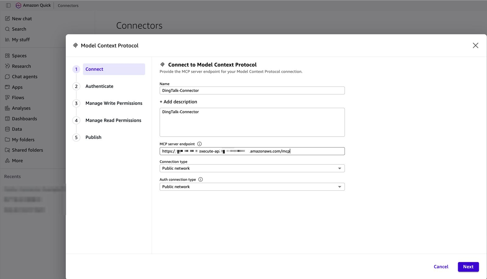
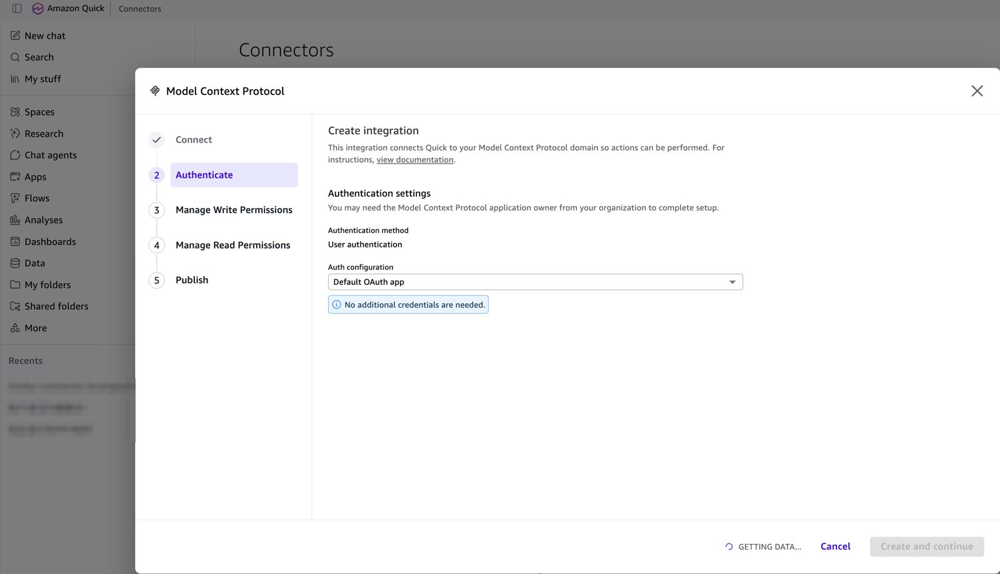
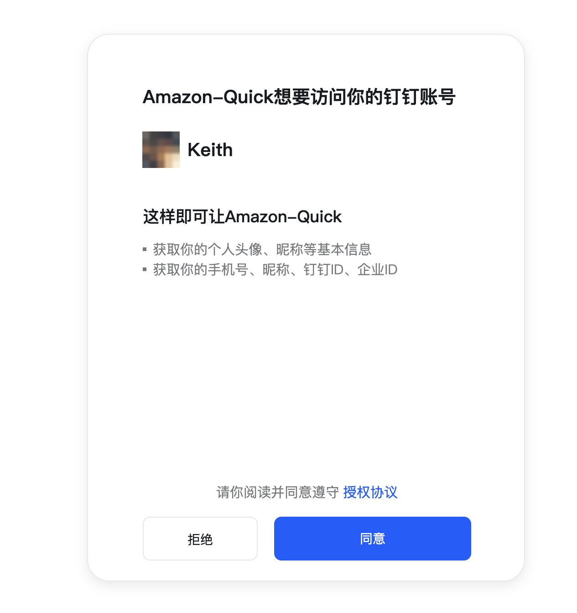
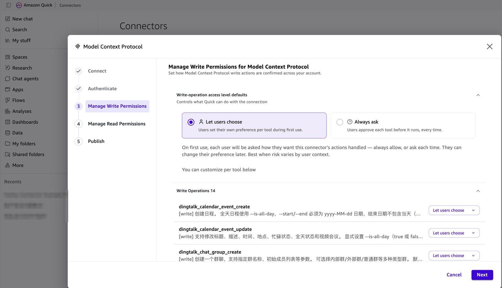
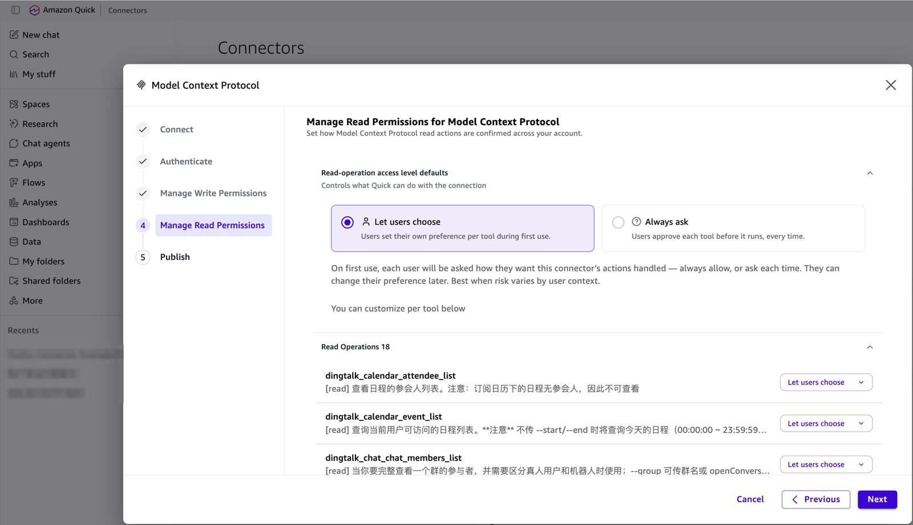
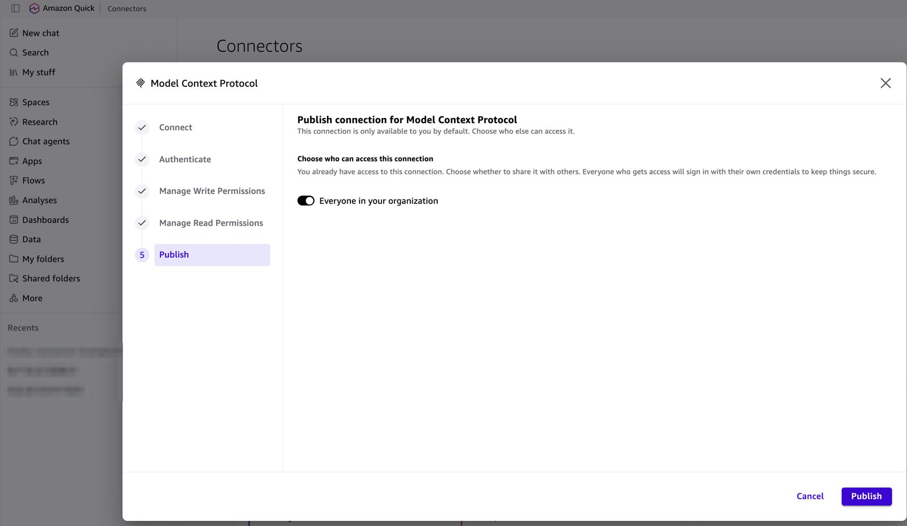
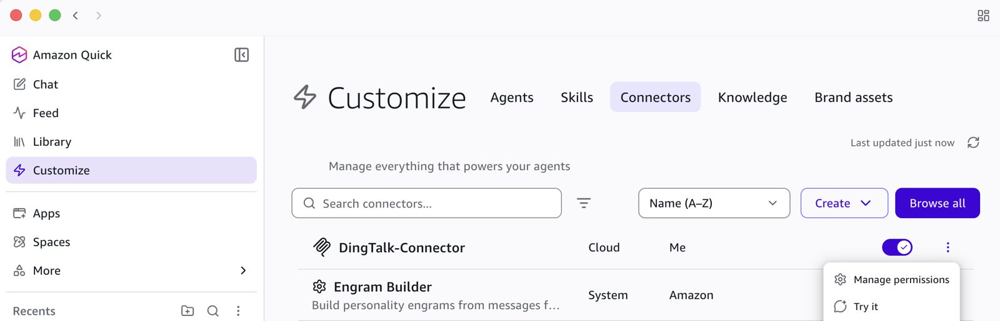
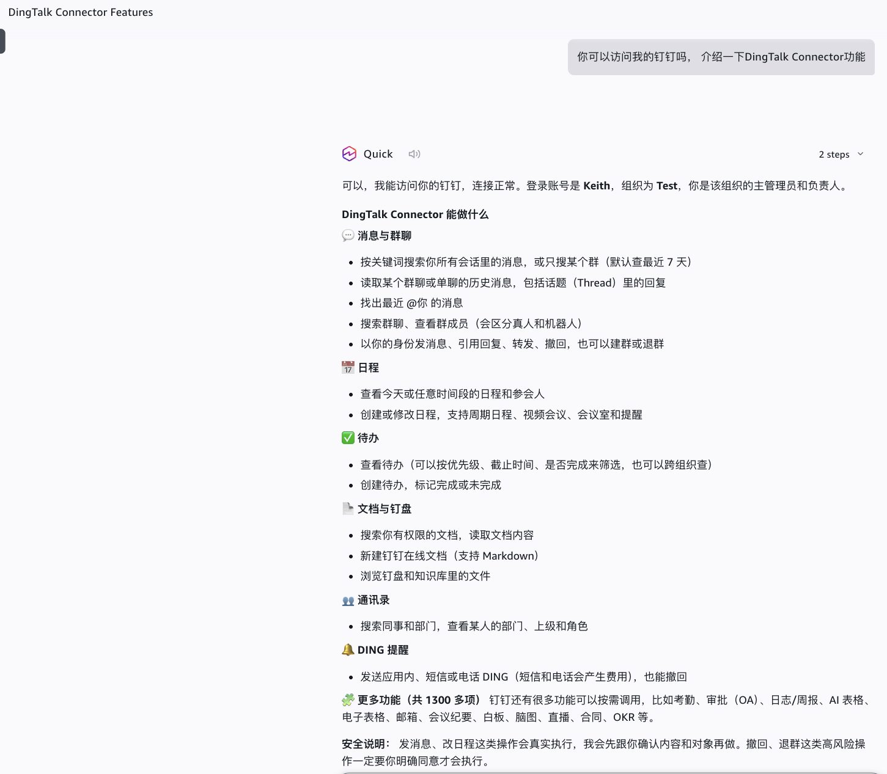

简体中文 | [English](../en/quick-walkthrough-dingtalk.md)

# Amazon Quick 接入钉钉实操（Default OAuth app）

本文演示如何把 Amazon Quick 接入钉钉部署，每一步都附截图。Quick 使用 **Default OAuth app**，也就是动态客户端注册：只需粘贴 MCP 端点，不用填写 Client ID、secret 或任何 URL。通用版教程和完整的常见问题表见 [client-amazon-quick.md](client-amazon-quick.md)。

已在真实钉钉组织（ap-southeast-1）中端到端验证：`POST /register 201` → `GET /callback 302` → `POST /token 200` → `POST /mcp 200`。

## 准备工作

| 检查项 | 位置 |
|---|---|
| 组织已开启 CLI 访问 | [im-setup-dingtalk.md 第 1 步](im-setup-dingtalk.md#1-为组织开通-cli-访问管理员) |
| 已开通 `Contact.User.Read` 并发布应用版本 | [第 4 步](im-setup-dingtalk.md#4-申请权限并发布) |
| 已写入 Client Secret | [第 5 步](im-setup-dingtalk.md#5-部署后写入-client-secret) |
| 已在安全设置中登记 `CallbackUrl` | [第 6 步](im-setup-dingtalk.md#6-部署后登记重定向-url) |

## 1. Connect

在 Amazon Quick 打开 **Connectors** → **Create for your team** → **Model Context Protocol**（如有提示，选择 **No, create new**），填写：

| 字段 | 值 |
|---|---|
| Name | 例如 `DingTalk-Connector` |
| MCP server endpoint | Stack 输出 `McpUrl`（`https://<base>/mcp`） |
| Connection type / Auth connection type | **Public network** |

点击 **Next**。

## 2. Authenticate：Default OAuth app

**Auth configuration** 选择 **Default OAuth app**（页面提示 "No additional credentials are needed"），点击 **Create and continue**。Quick 自动注册并打开登录窗口，期间显示 "GETTING DATA..."。

## 3. 在钉钉中授权

钉钉页面提示应用想要访问你的钉钉账号：基本信息、手机号、昵称、钉钉 ID、企业 ID。确认账号无误后点击**同意**。

## 4. 管理写权限

Quick 列出钉钉的写操作工具（14 个），例如 `dingtalk_calendar_event_create`、`dingtalk_chat_group_create`。选择 **Let users choose** 或 **Always ask**（组织内共享时推荐），也可以按工具单独设置。点击 **Next**。

工具说明来自钉钉 CLI，因此是中文。

## 5. 管理读权限

读操作工具（18 个），例如 `dingtalk_calendar_event_list`、`dingtalk_chat_chat_members_list`。点击 **Next**。

## 6. 发布

打开 **Everyone in your organization** 共享 connector。每个使用者第一次使用时仍要用自己的钉钉账号登录。点击 **Publish**。

## 7. 使用

在 Quick Desktop 的 **Customize → Connectors** 中可以看到 **DingTalk-Connector**，确认开关已打开。可以用 **Try it** 测试，之后也可以通过 **Manage permissions** 修改确认方式。

在对话中提问，例如"你可以访问我的钉钉吗？介绍一下 DingTalk Connector 功能"。Quick 会以登录用户本人的身份回答，并列出消息、日程、待办、文档与钉盘、通讯录、DING 等功能，另外还有约 1300 个命令可以通过 `dingtalk_discover` / `dingtalk_invoke` 调用。

## 出错时

| 现象 | 处理 |
|---|---|
| 钉钉页面提示重定向错误 | 安全设置中没有保存 `CallbackUrl`，或版本未发布（[第 6 步](im-setup-dingtalk.md#6-部署后登记重定向-url)） |
| "授权失败，链接已过期或已被使用" | 登录页被打开了两次。从 connector 重新发起；如果再次失败，查看 `oauth` Lambda 日志中的 `im_exchange_failed`（通常是未开通 `Contact.User.Read`） |
| 工具返回 `im_admin_action_required` | 组织未开启 CLI 访问（[第 1 步](im-setup-dingtalk.md#1-为组织开通-cli-访问管理员)） |
| 工具返回 `missing_scope` | 在权限管理中开通该权限并发布，然后打开结果中的 `authorize_url` |
